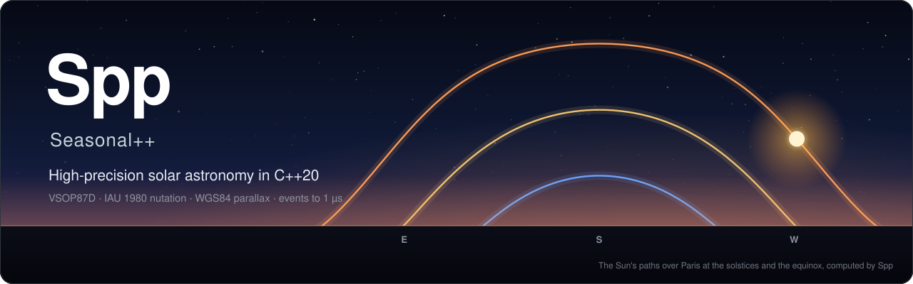

<p align="center">
  
</p>

<p align="center">
  <a href="https://github.com/Nouni2/Seasonal-plus-plus/releases/tag/v1.0.1"></a>
  <a href="#building"></a>
  <a href="#building"></a>
  <a href="#accuracy--precision"></a>
  <a href="#floating-point-policy"></a>
  <a href="LICENSE"></a>
  <a href="http://github.com/Nouni2/Seasonal-plus-plus/wiki"></a>
</p>

<p align="center">
  <b>Where the Sun is, and when it rises, transits and sets: anywhere, from 1000 BC to 3000 AD.</b><br>
  Full VSOP87D ephemeris · strict IEEE 754 fp64 · ~0.5 µs per sky position (warm cache) · events solved to 1 µs
</p>

Spp is a C++20 library for solar positional astronomy: apparent geocentric coordinates, topocentric refracted altitude and azimuth, sidereal time, nutation, ΔT, and solar event instants from 1000 BC to 3000 AD.

The library is the engine. All computation is exposed through `include/spp/`. The `spp` CLI front-end prints a subset of these results.

Built for batch evaluation across dates and observer grids. Calculations are verified against an 80-bit extended-precision reference to within double-precision rounding.

```powershell
$ spp day 2026-06-21 48.8566 2.3522 35
type      NORMAL
transit   2026-06-21T11:52:24Z
sunrise   2026-06-21T03:46:32Z
sunset    2026-06-21T19:58:17Z
duration  16.1959 h
```

---

## Features

- **Coordinates**: Apparent geocentric equatorial (RA, Dec, distance) and topocentric horizontal (true and refracted altitude, azimuth).
- **Events**: Root-finders for transit, twilight boundaries (civil, nautical, astronomical), and sunrise/sunset (refracted upper limb touching horizon). Polar day and polar night handling.
- **Astronomical Models**:
  - Earth heliocentric orbit: **VSOP87D** (compiled in, 2,425 terms).
  - Nutation: **IAU 1980** (106 periodic terms).
  - Sidereal time: **IAU 1982** GMST and GAST in split precision.
  - Earth orientation & ΔT: **IERS EOP 20 C04** (1972–2026 monthly table) and Espenak–Meeus polynomials.
  - Atmospheric refraction: Sæmundsson model with local elevation, temperature, and pressure scaling.
- **Dependencies**: None. Relies exclusively on standard C++20. Tables are embedded as compile-time constants.
- **Throughput**: ~0.5 µs per position on warm Chebyshev cache; event solutions converge to 1 µs.

---

## Building

Requires a C++20 conforming compiler (GCC 14+, Clang 18+, or MSVC 2022) and CMake 3.28+.

```bash
# Configure and build the library and command-line tools
cmake -B build -DCMAKE_BUILD_TYPE=Release
cmake --build build --config Release
```

Using presets (Ninja + GCC/UCRT64):

```bash
cmake --preset release
cmake --build --preset release
```

### CMake Integration

Spp installs standard CMake package files:

```cmake
find_package(Spp 1.0 CONFIG REQUIRED)
target_link_libraries(your_app PRIVATE spp::spp)
```

---

## C++ Example

```cpp
#include <iostream>
#include <spp/spp.hpp>

int main() {
    using namespace spp;

    // Define observer: Paris (48.8566° N, 2.3522° E, 35 m elevation)
    const Observer obs{
        .lat_deg = 48.8566,
        .lon_deg = 2.3522,
        .elev_m  = 35.0
    };

    // Construct a UTC timestamp
    const Time t = Time::from_civil(2026, 6, 21, 12, 0, 0.0);

    // 1. Topocentric solar coordinates (apparent position with atmospheric refraction)
    const Horizontal sky = sun::horizontal(t, obs);
    std::cout << "Altitude: " << sky.alt_deg << "°\n";
    std::cout << "Azimuth:  " << sky.az_deg  << "°\n";

    // 2. Solar events for the date
    const events::Day day = events::day({2026, 6, 21}, obs);
    if (day.type == events::DayType::Normal && day.rise && day.set) {
        std::cout << "Transit: " << day.transit.iso_utc() << "\n";
        std::cout << "Sunrise: " << day.rise->iso_utc()    << "\n";
        std::cout << "Sunset:  " << day.set->iso_utc()     << "\n";
    }

    return 0;
}
```

---

## Accuracy & Precision

### Floating-Point Policy
Computations run in IEEE 754 binary64 (`double`). Compiler flags disable `-ffast-math` and FMA contraction (`-ffp-contract=off`) to maintain deterministic instruction order across architectures.

### Verification
- **Solar Position**: Within ≤ 0.064″ topocentric altitude/azimuth against JPL DE421 (2000–2026).
- **Nutation & Sidereal Time**: Matches ERFA / IAU SOFA to 0.0008 mas (IAU 1980) and 0.5 mas (IAU 1982 GMST).
- **Solar Events**: Sunrise/sunset instants agree with DE421 geometry to ≤ 11 ms (latitudes 0°–64°) and ≤ 6.4 × 10⁻⁶″ of refracted upper limb altitude.
- **Full Pipeline**: Verified against an 80-bit extended-precision evaluation (`tools/pipeline_check.cpp`).

---

## Performance

| Evaluation Type | Time per Evaluation | Notes |
|---|---|---|
| **Warm Cache** | ~0.5 µs | Consecutive instants within the active Chebyshev interval |
| **Cold Cache** | ~0.46 ms | Evaluating a random date requiring full VSOP87D series summation |
| **Solar Day Events** | ~8–12 µs | Complete day classification, transit, sunrise, and sunset solution |

*Benchmarked on AMD Ryzen / Linux GCC 14.2 Release. See `tools/bench.cpp`.*

---

## Limitations

- **Solar body only**: Computes solar coordinates and events. Lunar and planetary ephemerides are out of scope.
- **Platform `libm`**: While compiler code generation is deterministic, transcendental functions (`sin`, `cos`, `atan2`) depend on the host C runtime and may differ by the last ULP.
- **Pre-1600 ΔT**: Historical ΔT uncertainty dominates timing precision prior to 1600 AD.

---

## Extended Documentation (Wiki)

In-depth astronomical derivations, tutorials, and full API references are hosted on the [Project Wiki](http://github.com/Nouni2/Seasonal-plus-plus/wiki):

- [Getting Started & Installation Guide](http://github.com/Nouni2/Seasonal-plus-plus/wiki/Getting-Started)
- [C++ API Reference](http://github.com/Nouni2/Seasonal-plus-plus/wiki/Library-API)
- [Solar Position Pipeline](http://github.com/Nouni2/Seasonal-plus-plus/wiki/Solar-Position)
- [Event Solvers & Day Types](http://github.com/Nouni2/Seasonal-plus-plus/wiki/Events)
- [Time Scales & ΔT Calibration](http://github.com/Nouni2/Seasonal-plus-plus/wiki/Time-and-Delta-T)
- [Validation Tools & Audit Reproduction](http://github.com/Nouni2/Seasonal-plus-plus/wiki/Validation-Tools)
- [Known Issues & Workarounds](http://github.com/Nouni2/Seasonal-plus-plus/wiki/Known-Issues)
- [Roadmap](http://github.com/Nouni2/Seasonal-plus-plus/wiki/Roadmap)

---

## Contributing

Please see [CONTRIBUTING.md](CONTRIBUTING.md) for precision policies, development standards, and test verification requirements.

---

## License

Spp is licensed under the [GNU General Public License v3.0 or later](LICENSE).

