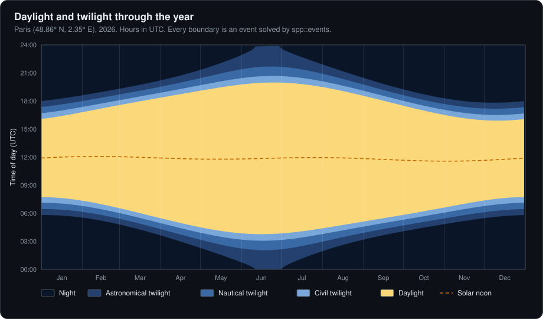
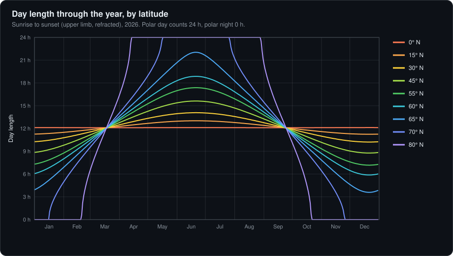
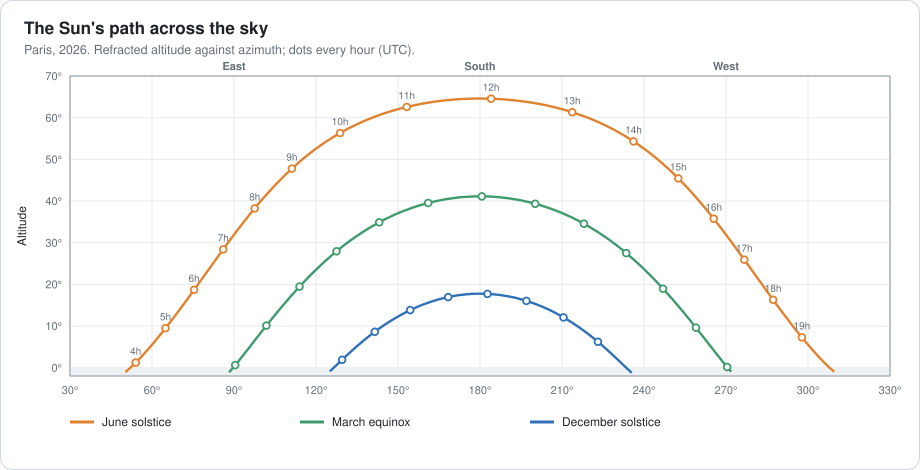
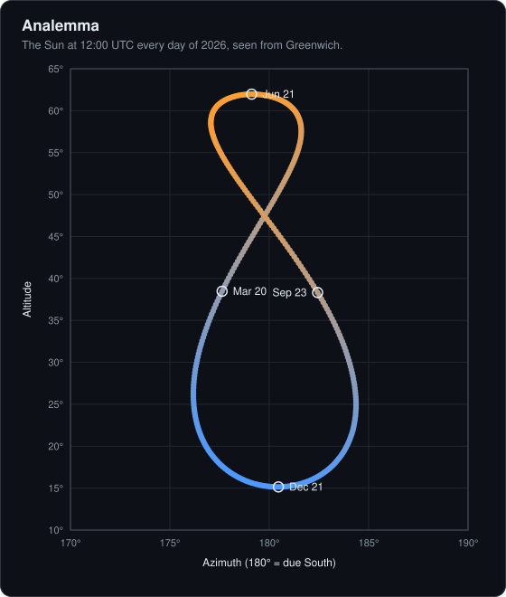
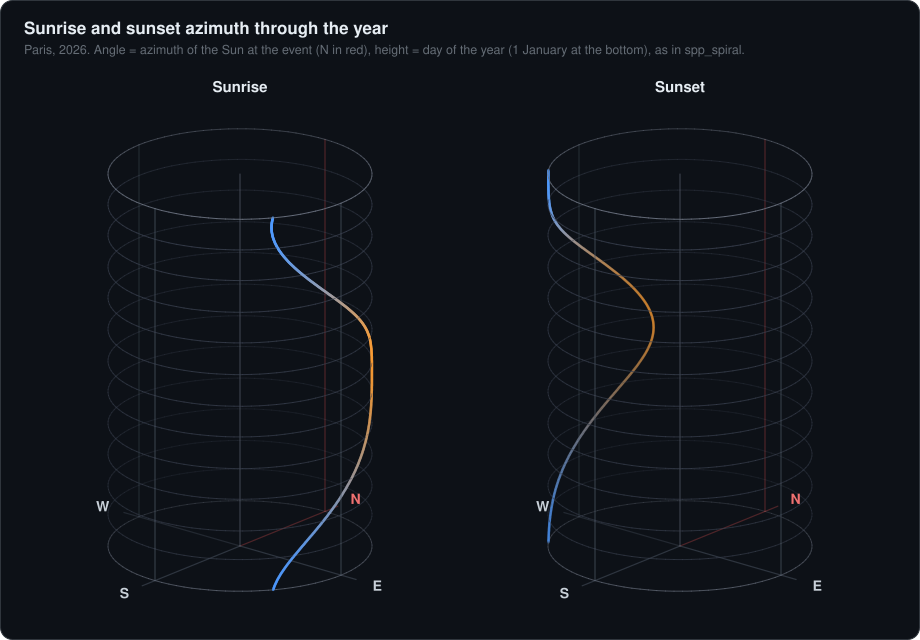

<p align="center">
  
</p>

<p align="center">
  <a href="#changelog"></a>
  <a href="#building"></a>
  <a href="#building"></a>
  <a href="#3-heliocentric-earth-vsop87d"></a>
  <a href="#floating-point-policy"></a>
  <a href="#features"></a>
  <a href="LICENSE"></a>
  <a href="http://github.com/Nouni2/Seasonal-plus-plus/wiki"></a>
</p>

<p align="center">
  <b>Where the Sun is, and when it rises, transits and sets: anywhere, from 1000 BC to 3000 AD.</b><br>
  Full VSOP87D ephemeris · strict IEEE 754 fp64 · ~0.5 µs per sky position (warm cache) · events solved to 1 µs
</p>

Spp is a C++20 library for high-precision solar positional astronomy. It
computes where the Sun is and when it rises, transits and sets: apparent
geocentric coordinates, topocentric refracted altitude and azimuth, sidereal
time, nutation, ΔT, and event instants for any place and date from 1000 BC to
3000 AD.

**The library is the engine.** Everything Spp can compute is available through
its C++ API (`include/spp/`). The `spp` executable is a small demonstration
front end that prints a few fixed results. It is not the engine, and what it
does not print says nothing about what the engine can compute. See
[What the `spp` executable is and is not](#what-the-spp-executable-is-and-is-not).

It is built for large batch workloads, such as every day of a year across a
grid of latitudes. It never trades accuracy for speed: every shortcut is
measured against an extended-precision evaluation of the same theory and must
match it to within double-precision rounding.

**Wiki.** The [project wiki](http://github.com/Nouni2/Seasonal-plus-plus/wiki) has this
documentation split into pages, the
[known issues](http://github.com/Nouni2/Seasonal-plus-plus/wiki/Known-Issues) of the
current release with workarounds, and the
[roadmap](http://github.com/Nouni2/Seasonal-plus-plus/wiki/Roadmap).

**Constitution.** The principles every change to Spp must respect (precision
first, correct definitions, honest claims and the rest) are in
[CONSTITUTION.md](CONSTITUTION.md).

```
$ spp day 2026-06-21 48.8566 2.3522 35
type      NORMAL
transit   2026-06-21T11:52:24Z
sunrise   2026-06-21T03:46:57Z
sunset    2026-06-21T19:57:52Z
duration  16.1820 h
```

---

## Contents

- [Gallery](#gallery)
- [Features](#features)
- [Building](#building)
- [Command-line tool](#command-line-tool) (a demonstration front end, not the engine)
- [Azimuth spirals](#azimuth-spirals)
- [Library](#library)
- [Conventions](#conventions)
- [Theory](#theory)
  1. [Pipeline](#1-pipeline)
  2. [Time](#2-time)
  3. [Heliocentric Earth: VSOP87D](#3-heliocentric-earth-vsop87d)
  4. [Geometric geocentric Sun](#4-geometric-geocentric-sun)
  5. [Nutation](#5-nutation)
  6. [Obliquity of the ecliptic](#6-obliquity-of-the-ecliptic)
  7. [Aberration and the apparent longitude](#7-aberration-and-the-apparent-longitude)
  8. [Ecliptic to equatorial](#8-ecliptic-to-equatorial)
  9. [Sidereal time and hour angle](#9-sidereal-time-and-hour-angle)
  10. [Topocentric parallax](#10-topocentric-parallax)
  11. [Horizontal coordinates](#11-horizontal-coordinates)
  12. [Atmospheric refraction](#12-atmospheric-refraction)
  13. [Events](#13-events)
- [Numerical methods](#numerical-methods)
- [Accuracy](#accuracy)
- [Performance](#performance)
- [Accuracy tools](#accuracy-tools)
- [Project layout](#project-layout)
- [Limitations](#limitations)
- [References](#references)
- [Changelog](#changelog)
- [License](#license)

---

## Gallery

Every figure in this README is computed by the library and drawn by
`spp_figures` (see [Accuracy tools](#accuracy-tools)).

**Daylight and twilight through the year in Paris.** Every boundary is an event
solved by `spp::events`: sunrise and sunset, then civil (−6°), nautical (−12°)
and astronomical (−18°) twilight. Around the June solstice astronomical
twilight lasts all night, because at 48.86° N the Sun never gets 18° below the
horizon.



**Day length through the year, from the equator to 80° N.** The curves meet
just above 12 h, a few days before the March equinox and after the September
one: refraction and the Sun's radius make the day at the equinox slightly
longer than 12 h (12.11 h at the equator, 12.16 h in Paris on 20 March).
Above the Arctic Circle the curves reach the polar day (24 h) and polar night
(0 h) plateaus.



**The Sun's path across the sky over Paris** at the June solstice, the March
equinox and the December solstice. On these dates solar noon falls a few
minutes before 12:00 UTC (11:52, 11:58 and 11:49, to the nearest minute): Paris lies 2.35° east of
Greenwich, 9 minutes of time, and the equation of time adds or removes a few
more.



**The analemma.** The Sun photographed at the same clock time every day traces
a figure eight. The vertical extent is the change in declination over the year;
the horizontal swing is the equation of time, from the eccentricity of the
Earth's orbit and the tilt of its axis.



**Where the Sun rises and sets.** The azimuth of sunrise and sunset over the
year as spirals, the same view as the interactive `spp_spiral` viewer. In
Paris, sunrise swings between 51.6° (northeast, June) and 126.0° (southeast,
December), and sunset between 234.0° and 308.4°.



---

## Features

- **Solar ephemeris.** The full VSOP87D Earth series (2,425 terms) is compiled
  into the binary as exact hex-float literals, so there are no data files at
  runtime.
- **Apparent place.** Nutation, annual aberration and true obliquity, giving
  right ascension and declination referred to the true equator and equinox of
  date.
- **Earth rotation.** GMST, GAST and local apparent sidereal time, with optional
  DUT1.
- **Time scales.** UTC, UT1 and TT are distinct C++ types, so mixing them is a
  compile error. ΔT comes from observed values and long-term fits. Dates are
  stored as a split Julian Date for full precision over millennia.
- **Observer corrections.** Topocentric parallax on the WGS84 ellipsoid with
  elevation, and atmospheric refraction scaled for pressure and temperature.
- **Events.** Meridian transit, sunrise and sunset (upper limb), civil, nautical
  and astronomical twilight, or any target altitude. Days are classified as
  normal, polar day or polar night.
- **Speed.** About 0.5 µs for a refracted topocentric altitude and about 8 µs for
  a complete sunrise/transit/sunset day, on one core, when consecutive queries
  stay within cached 16-day segments. A query in a new segment first fills it,
  about 0.9 ms ([Performance](#performance)).
- **Portable standard C++.** The library has no dependencies beyond the
  standard library. Only the optional `spp_spiral` viewer uses OpenGL.

---

## Building

### Requirements

- A C++20 compiler; the executables use C++23 for `std::print`. Developed with
  GCC 15.2 (MSYS2 UCRT64 on Windows); also built and checked with GCC 14.2 and
  Clang 18 (with libstdc++) on Linux x86-64. Where the standard library keeps
  part of `std::print` in `libstdc++exp`, the configure step detects it with
  a test link and links it, whatever the compiler.
- CMake ≥ 3.28 and Ninja.
- Optional, for `spp_spiral`: GLFW 3, GLEW, GLM and OpenGL 3.3. The target is
  built automatically when they are found, and skipped otherwise.

### Build

```sh
cmake --preset release
cmake --build --preset release
./build/release/spp day 2026-06-21 48.8566 2.3522
```

| Preset | Output | Purpose |
|---|---|---|
| `release` | `build/release/` | Optimized |
| `debug` | `build/debug/` | Debug information, no optimization |

**Cross-compiling.** `vsop_gen`, which generates the VSOP87D tables, runs on
the build machine. With `CMAKE_CROSSCOMPILING_EMULATOR` set (for example
`qemu-aarch64`), it is built for the target and run through the emulator.
Without an emulator, it is built for the host with `SPP_HOST_CXX` (default
`c++`, any compiler taking GCC/Clang options), or taken from
`SPP_VSOP_GEN_EXECUTABLE`. Both paths were checked with an aarch64 Linux
cross toolchain (GCC 14.2): the generated tables are byte-identical to a
native build.

```sh
cmake -S . -B build-arm --toolchain aarch64.cmake -DSPP_HOST_CXX=g++
```

CMake options:

| Option | Default | Effect |
|---|---|---|
| `SPP_NATIVE` | `OFF` | Adds `-march=native` |
| `SPP_BUILD_APPS` | top level | Builds `spp` and, when GLFW/GLEW/GLM are found, `spp_spiral` |
| `SPP_BUILD_VALIDATION` | top level | Builds the accuracy tools: `spp_cache_check`, `spp_pipeline_check`, `spp_day_scan`, `spp_readme_numbers` and `spp_dump` ([Accuracy tools](#accuracy-tools)) |
| `SPP_BUILD_BENCH` | `OFF` | Builds the `spp_bench` benchmark |
| `SPP_BUILD_FIGURES` | `OFF` | Builds `spp_figures`, which renders the README figures |
| `SPP_INSTALL` | top level | Generates the install rules and the CMake package |

"Top level" means `ON` when Spp is built on its own and `OFF` when it is
included by another project, which then gets only the library.

### Using Spp from another project

Spp builds as a static library, `libspp.a`, or `libsppd.a` for Debug. Install it
together with its headers and a CMake package:

```sh
cmake --preset release && cmake --build --preset release && cmake --install build/release
cmake --preset debug   && cmake --build --preset debug   && cmake --install build/debug
```

The presets install into `install/` at the repository root (ignored by git).
Both configurations can share this prefix:

```
install/
├── include/spp/...               public headers
├── lib/libspp.a, lib/libsppd.a   Release and Debug archives
├── lib/cmake/Spp/                SppConfig.cmake, version file, targets
└── share/licenses/Spp/LICENSE
```

The consuming project finds the package and links the `spp::spp` target. The
target carries the include path and the C++20 requirement:

```cmake
find_package(Spp 1.0 CONFIG REQUIRED)
target_link_libraries(app PRIVATE spp::spp)
```

Point CMake at the prefix when configuring, for example with
`-DCMAKE_PREFIX_PATH=<path to Seasonal++>/install`. The library has no
dependencies outside the C++ standard library.

Alternatively, add the source tree directly, which builds only the library:

```cmake
add_subdirectory(<path to Seasonal++> spp)
target_link_libraries(app PRIVATE spp::spp)
```

The [floating-point flags](#floating-point-policy) are private to the library's
own sources and are not passed to consumers. There is one exception: the inline
angle helpers `norm360` and `wrap180` in `spp/core/angles.hpp`. If a program
uses them in a file built with `-ffast-math`, the linker keeps only one copy of
each, and that copy may be the fast-math one. Build such files without
fast-math.

The build first compiles `tools/vsop_gen`, which turns `data/VSOP87D.ear` into
`build/<preset>/generated/spp/vsop87d_earth_terms.inc` (see
[VSOP87D tables](#vsop87d-tables)).

On Windows with MSYS2, the executables link against the UCRT64 runtime DLLs,
so `C:\msys64\ucrt64\bin` must be on `PATH` to run them.

### Floating-point policy

All targets are compiled with:

- `-fno-fast-math`: strict IEEE 754 semantics.
- `-ffp-contract=off`: no implicit fused multiply-add, so the compiler
  generates the same arithmetic whatever the target CPU.
- `-fexcess-precision=standard`: no hidden extended-precision intermediates.
  This matters only where floating point runs on the x87 unit (32-bit x86
  without SSE2). On x86-64, which uses SSE2, the library compiles to identical
  machine code with and without it (GCC 14.2, all 13 sources); it is kept for
  x87 targets.

All computation is in `double`.

**What this does and does not guarantee.** The flags rule out
compiler-introduced contraction and excess precision. They do not make results
bit-identical everywhere: `sin`, `cos`, `atan2`, `pow` and the other
transcendental functions come from the platform's C math library (glibc, the
Windows UCRT, Apple libm), which is not correctly rounded, so the last bits
can differ between platforms. On one platform they can also differ between
CPUs: glibc on x86-64 selects FMA/AVX2 variants of these functions at run
time. Measured on Linux x86-64 (glibc 2.39, GCC 14.2), turning those variants
off (`GLIBC_TUNABLES=glibc.cpu.hwcaps=-AVX2,-FMA`) changes 320 of 20,000
positions, by at most 5.7 × 10⁻¹⁴° (2 × 10⁻¹⁰″); each mode is deterministic
from run to run. `tools/reference_check.py` measures this (section
`libm_dispatch`). Between platforms, the same 20,000 positions computed on
x86-64 (default glibc variants) and on aarch64 (GCC 14.2 cross-compiled,
glibc 2.39, run under QEMU) were bit-identical. The differences are of the
size of double rounding, far below every model error.

---

## Command-line tool

### What the `spp` executable is and is not

**It is** a thin demonstration front end (`apps/spp/main.cpp`, about 180
lines). It parses arguments, calls a handful of library functions and prints
the results. It contains no astronomy of its own. It exists for quick one-off
queries and for checking results by eye.

**It is not** the engine, and not a complete interface to it. It offers three
fixed outputs (`sun`, `day`, `year`) and exposes only a small part of the API.
For example, it prints sunrise and sunset *times* but not the Sun's azimuth at
those times. It prints no twilight instants, no altitude curves and no events
for custom target altitudes. The library computes all of these.

**Rule:** if the executable doesn't print something, that is a limitation of
the executable, never of Spp. To get anything else, write a C++ program that
links the `spp` library and calls the API directly (see [Library](#library)).
Any quantity the API provides can be computed at any instant, combined with
others, and fed to whatever consumes it (files, plots, visualizations).
Extending the executable is optional and never required to use the engine.

### Commands

```
spp sun  YYYY-MM-DD HH:MM[:SS] [LAT LON [ELEV]]   Sun at a UTC instant
spp day  YYYY-MM-DD LAT LON [ELEV]                transit, sunrise, sunset, day length
spp year YYYY LAT LON [ELEV]                      one CSV row per day

options:
  --dut1=S          UT1 - UTC in seconds (default: estimated, see §2.5)
  --pressure=MBAR   surface pressure for refraction (default: 1010 mbar at sea
                    level, scaled to the elevation)
  --temp=C          surface temperature for refraction (default 10)
  --no-refraction   geometric altitudes
```

Latitude is in degrees, positive North. Longitude is in degrees, positive East.
Elevation is in metres. All times are UTC. Negative (astronomical) years are
accepted, e.g. `-0100-03-01`.

### `spp sun`

At the March equinox of 2026, λ passes through 0°:

```
$ spp sun 2026-03-20 14:46 48.8566 2.3522 35
time        2026-03-20T14:46:00Z  (ΔT 69.13 s, DUT1 +0.057 s estimated)
ecliptic    λ 0.00004519°  β 0.00010129°  R 0.995917594 AU
equatorial  α 0.00000117° (0.00000008 h)  δ 0.00011091°
nutation    Δψ 6.2158"  Δε 9.1308"  ε 23.43841879°
sidereal    GMST 39.64803842°  GAST 39.64962255°
horizontal  alt 29.298467° (geometric 29.268595°)  az 230.093945°
```

Without a location, only the geocentric lines are printed.

### `spp day`

Tromsø at the June solstice, above the Arctic Circle:

```
$ spp day 2026-06-21 69.6492 18.9553
type      POLAR_DAY
transit   2026-06-21T10:45:59Z
sunrise   -
sunset    -
duration  24.0000 h
```

Events are reported in UTC. For Sydney, sunrise falls on the previous UTC date:

```
$ spp day 2026-12-21 -33.8688 151.2093 58
type      NORMAL
transit   2026-12-21T01:53:01Z
sunrise   2026-12-20T18:40:37Z
sunset    2026-12-21T09:05:26Z
duration  14.4138 h
```

### `spp year`

```
$ spp year 2026 48.8566 2.3522
date,type,transit_utc,sunrise_utc,sunset_utc,duration_h
2026-01-01,NORMAL,2026-01-01T11:54:09Z,2026-01-01T07:43:58Z,2026-01-01T16:04:31Z,8.342458
2026-01-02,NORMAL,2026-01-02T11:54:37Z,2026-01-02T07:43:55Z,2026-01-02T16:05:31Z,8.360203
...
```

Event times are full ISO timestamps, because they can fall on the UTC date
before or after the row's date. For 1582, the ten days removed by the
Gregorian reform (October 5–14) are skipped.

---

## Azimuth spirals

`spp_spiral` plots where the Sun rises and sets over a whole year, as two 3D
spirals in cylindrical coordinates. It is a separate program built directly on
the library. It computes the Sun's azimuth at each sunrise and sunset with the
public API, which the `spp` executable does not print.

```
spp_spiral YEAR LAT LON [ELEV]
```


It opens two windows, **sunrise** and **sunset**. In each one, every day of
the year is a point:

| Coordinate | Meaning |
|---|---|
| Angle | Azimuth of the Sun at the event: 0° = North (red), 90° = East |
| Height | Day of the year: 1 January at the bottom, 31 December at the top |
| Radius | 1 (no meaning) |

- **Points** are colored by season: blue around January, orange around July.
- **Guides:** faint rings mark the 1st of each month, and N/E/S/W letters mark
  both ends of the cylinder.
- **Gaps:** days without the event, such as polar day or polar night, leave a
  gap in the spiral.
- **Console summary:** before the windows open, the program prints the azimuth
  range of each event and the dates where the extremes occur.

| Control | Action |
|---|---|
| Left drag | Orbit |
| Mouse wheel | Zoom |
| `T` | View from above (North up, East right) |
| `R` | Reset the view |
| `Esc` | Close the window |

How each azimuth is computed:

1. `events::day` gives the sunrise and sunset instants.
2. At each instant, `sun::horizontal` gives the Sun's topocentric azimuth: the
   apparent place, sidereal time, parallax and horizontal coordinates, with the
   same nutation throughout.

Refraction changes only the altitude, not the azimuth.

---

## Library

Link against the `spp` target and include `spp/spp.hpp`, or individual headers.
The library is C++20; this example prints with `std::println`, which needs
C++23.

```cpp
#include <print>
#include "spp/spp.hpp"

int main() {
    // An instant in UTC, and an observer (longitude positive East).
    const auto t = spp::Time::from_utc(2026, 3, 20, 14, 46, 0.0);
    const spp::Observer paris{48.8566, 2.3522, 35.0};

    // Apparent geocentric position of the Sun (uses Terrestrial Time).
    const spp::Equatorial eq = spp::sun::apparent(t.tt());
    std::println("RA {:.6f} h  Dec {:+.6f} deg", eq.ra_hours(), eq.dec_deg);

    // The Sun in the observer's sky: refracted altitude and azimuth.
    const spp::Horizontal sky = spp::sun::horizontal(t, paris);
    std::println("altitude {:+.6f} deg  azimuth {:.6f} deg", sky.alt_deg, sky.az_deg);

    // Sunrise, sunset and day length. Next to polar day or night either can be
    // missing, so check before use.
    const auto day = spp::events::day({2026, 6, 21}, paris);
    if (day.rise && day.set)
        std::println("sunrise {}  sunset {}  {:.4f} h", day.rise->iso_utc(), day.set->iso_utc(),
                     day.duration_hours);

    // Civil twilight: the Sun's center 6 deg below the horizon, either side of transit.
    const auto dusk = spp::events::crossing(day.transit, paris, {}, spp::events::civil_twilight_deg,
                                            spp::events::Direction::After);
    if (dusk) std::println("civil dusk {}", dusk->iso_utc());
}
```

```
RA 0.000000 h  Dec +0.000111 deg
altitude +29.298467 deg  azimuth 230.093945 deg
sunrise 2026-06-21T03:46:57Z  sunset 2026-06-21T19:57:52Z  16.1820 h
civil dusk 2026-06-21T20:40:32Z
```

### API overview

The public API has two layers. The object namespaces (`sun`, `earth`, `sky`,
`events`) are what most code uses. `spp::model::<theory>` exposes the
underlying theories directly, each named after its source, so which model
produced a number is always explicit.

#### `spp::` — core types (`spp/core/`)

| Symbol | Description |
|---|---|
| `Time` | An instant held in UTC, with its DUT1 |
| `Time::from_utc(y, mo, d, h, mi, s [, dut1])` | From a civil UTC date and time; DUT1 is estimated when omitted ([§2.5](#25-time-scales)). Throws `std::invalid_argument` for a date that does not exist (`is_valid`) or a non-finite second or DUT1; hours, minutes and seconds outside their ranges carry over (24:00 is 0:00 of the next day) |
| `Time::from_civil(CivilDateTime, dut1)` | Same, from a struct |
| `Time::from_jd(day, frac, dut1)` | From a split Julian Date (normalized). Throws `std::invalid_argument` for a non-finite `frac` or DUT1, or \|frac\| ≥ 2⁵² |
| `t.utc()`, `t.ut1()`, `t.tt()` | The instant as `Instant<UTC/UT1/TT>` |
| `t.delta_t()`, `t.dut1()` | ΔT = TT − UT1 and DUT1 = UT1 − UTC, seconds |
| `t.tt_minus_utc()`, `t.dut1_estimated()` | TT − UTC in seconds; whether DUT1 was estimated rather than given |
| `tai_minus_utc(Instant<UTC>)` | TAI − UTC from the leap-second table, or empty outside 1972 – 2027-06-28 |
| `t.decimal_year()` | The year value used to evaluate ΔT |
| `t.shifted(days)` | Another instant, same DUT1 |
| `t.to_civil()`, `t.iso_utc()` | Civil UTC date and time; ISO 8601 rounded to the second |
| `iso_date(CivilDate)` | `YYYY-MM-DD`; years outside 0…9999 in the ISO 8601 expanded form, with a sign and at least four digits (`-0100-03-01`) |
| `Instant<Scale>` | `{day, frac}` split Julian Date; `days_since_j2000()`, `centuries_since_j2000()`. Any `frac` is accepted: functions that take an `Instant` normalize it first |
| `CivilDate`, `CivilDateTime` | Calendar dates (Julian before 1582-10-15, Gregorian after) |
| `is_gregorian(CivilDate)` | Whether a date is on or after 1582-10-15 |
| `is_valid(CivilDate)` | Whether a date exists: month 1–12, day within the month (Julian leap years before 1582-10-15, Gregorian after), not 1582-10-05 to 1582-10-14 |
| `Ecliptic` | `lon_deg`, `lat_deg`, `dist_au` |
| `Equatorial` | `ra_deg`, `dec_deg`, `dist_au`, `ra_hours()` |
| `Horizontal` | `alt_deg`, `az_deg` |
| `Observer` | `lat_deg`, `lon_deg` (East +), `elev_m` |
| `Atmosphere` | `pressure_mbar` (unset: 1010 mbar at sea level, scaled to the observer's elevation), `temp_c` (10), `refraction` (true) |
| `norm360`, `wrap180` | Angle normalization |
| Constants (`spp/core/constants.hpp`) | `deg2rad`, `rad2deg`, `jd_j2000_day`, `days_per_century`, WGS84, solar constants |

#### `spp::sun` — the Sun from the geocenter (`spp/sun.hpp`)

| Function | Returns |
|---|---|
| `geometric(Instant<TT>)` | Geometric ecliptic position ([§4](#4-geometric-geocentric-sun)) |
| `apparent_ecliptic(Instant<TT>, Nutation)` | Plus nutation in longitude and aberration ([§7](#7-aberration-and-the-apparent-longitude)) |
| `apparent(Instant<TT> [, Nutation])` | Apparent RA and Dec, true equator and equinox of date ([§8](#8-ecliptic-to-equatorial)) |
| `semidiameter_deg(Instant<TT>)` | Apparent semidiameter, 959.63″ / R |
| `horizontal(Time, Observer [, Atmosphere])` | The Sun in the observer's sky: topocentric azimuth and refracted altitude ([§10](#10-topocentric-parallax)–[§12](#12-atmospheric-refraction)) |

#### `spp::earth` — Earth orientation (`spp/earth.hpp`)

| Function | Returns |
|---|---|
| `nutation(Instant<TT>)` | `Nutation{dpsi_deg, deps_deg, mean_obliquity_deg, true_obliquity_deg}` ([§5](#5-nutation), [§6](#6-obliquity-of-the-ecliptic)) |
| `mean_obliquity_deg(Instant<TT>)` | ε₀ |
| `delta_t(Time)` | ΔT, seconds ([§2.6](#26-δt)) |
| `gmst_deg(Instant<UT1>)` | Greenwich mean sidereal time ([§9](#9-sidereal-time-and-hour-angle)) |
| `equation_of_equinoxes_deg(Nutation)` | Δψ cos ε |
| `gast_deg(Instant<UT1>, Nutation)`, `gast_deg(Time)` | Greenwich apparent sidereal time |
| `lst_deg(Instant<UT1>, Nutation, lon)`, `lst_deg(Time, lon)` | Local apparent sidereal time |

#### `spp::sky` — the observer's sky (`spp/sky.hpp`)

| Function | Returns |
|---|---|
| `to_equatorial(Ecliptic, true_obliquity_deg)` | Ecliptic → equatorial ([§8](#8-ecliptic-to-equatorial)) |
| `to_horizontal(Equatorial, lat_deg, lst_deg)` | Equatorial → horizontal, geometric ([§11](#11-horizontal-coordinates)) |
| `parallax(Equatorial, Observer, lst_deg)` | Geocentric → topocentric ([§10](#10-topocentric-parallax)) |
| `refraction(geometric_alt_deg, Atmosphere)` | Apparent (refracted) altitude ([§12](#12-atmospheric-refraction)) |
| `diurnal_aberration(Equatorial, Observer, lst_deg)` | Shift from the observer's rotational velocity, up to 0.32″ ([§10](#10-topocentric-parallax)) |
| `at_elevation(Atmosphere, elev_m)` | The atmosphere with its pressure filled in for an elevation ([§12](#12-atmospheric-refraction)) |
| `observe(Equatorial, Observer, lst_deg, Atmosphere)` | Parallax, diurnal aberration, horizontal coordinates and refraction in one call: what the observer sees |

#### `spp::events` — events in time (`spp/events.hpp`)

| Symbol | Description |
|---|---|
| `altitude_deg(Time, Observer, Atmosphere)` | Full pipeline: apparent, topocentric, refracted altitude of the Sun's center |
| `transit(approx, lon, cfg)` | Meridian transit near an approximate instant ([§13.3](#133-transit)) |
| `crossing(transit, obs, atm, target_alt_deg, dir, cfg)` | Instant the Sun's center reaches a target altitude before or after transit; `nullopt` if it never does within 12 h ([§13.4](#134-crossings)). `transit` must be the transit for the observer's longitude (`transit()` or `Day::transit`); debug builds assert \|hour angle\| < 0.01° |
| `upper_limb_altitude_deg(Time, Observer, Atmosphere)` | Apparent altitude of the upper limb: the topocentric center raised by the semidiameter, then refracted ([§13.1](#131-definitions)) |
| `upper_limb_crossing(transit, obs, atm, target_alt_deg, dir, cfg)` | Instant the upper limb reaches a target apparent altitude; target 0 is sunrise or sunset ([§13.4](#134-crossings)) |
| `day(date, obs [, atm, dut1, cfg])` | `Day{date, type, transit, rise, set, duration_hours}` ([§13.2](#132-one-day)) |
| `upper_limb_deg` | −16′: the center's geometric altitude when the upper limb touches the geometric horizon (mean semidiameter), for use with refraction off |
| `civil_twilight_deg`, `nautical_twilight_deg`, `astronomical_twilight_deg` | −6°, −12°, −18° |
| `DayType` | `Normal`, `PolarDay`, `PolarNight` |
| `Direction` | `Before` (rising side), `After` (setting side) |
| `SolverConfig` | `time_tolerance_s` (1e-6), `max_iter` (60) |

#### `spp::model` — the theories (`spp/model/`)

| Namespace | Contents |
|---|---|
| `vsop87d` | `earth(t)`: heliocentric L, B, R of the Earth, t in Julian millennia of TT ([§3](#3-heliocentric-earth-vsop87d)) |
| `iau1980` | `nutation(T)`: Δψ, Δε in arcseconds ([§5](#5-nutation)) |
| `laskar` | `mean_obliquity_deg(T)` ([§6](#6-obliquity-of-the-ecliptic)) |
| `meeus` | Civil date ↔ Julian Date ([§2.2](#22-civil-date-to-julian-date), [§2.3](#23-julian-date-to-civil-date)); GMST ([§9](#9-sidereal-time-and-hour-angle)) |
| `espenak_meeus` | `delta_t_seconds(decimal_year)` ([§2.6](#26-δt)) |
| `saemundsson` | `apparent_altitude_deg(h, pressure, temperature)` ([§12](#12-atmospheric-refraction)) |

### Thread safety

All functions are thread-safe: they can be called from any number of threads
at once. The ephemeris cache (see
[Chebyshev earth state](#chebyshev-earth-state)) is `thread_local`, so threads
never share or lock it. Each thread that computes positions holds 67 KB of
cache.

They are not reentrant in the strict sense: the cache is hidden mutable
state, and its first use on a thread can allocate (where thread-local storage
is emulated). Do not call Spp from a signal handler.

---

## Conventions

| Quantity | Convention |
|---|---|
| Angles | Degrees unless the name says otherwise (`_rad`, `_arcsec`, `ra_hours()`) |
| Longitude | Positive East, −180 … +180 |
| Latitude | Geodetic, positive North |
| Azimuth | From North, increasing East (N = 0°, E = 90°, S = 180°, W = 270°) |
| Hour angle | Positive West of the meridian |
| Right ascension | Degrees in `ra_deg`; hours via `ra_hours()` |
| Elevation | Metres, applied on the WGS84 ellipsoid |
| Distance | Astronomical units |

### Time

- **Julian Dates** are stored split into an integer day and a fraction in
  [0, 1), where fraction 0 is noon ([§2.1](#21-julian-dates-and-split-storage)).
- **UTC** is the input and output scale. **UT1** = UTC + DUT1 drives Earth
  rotation (sidereal time). **TT** drives the ephemeris; from 1972 it is exact,
  TT = UTC + 32.184 s + (TAI − UTC) from the leap-second table.
- **DUT1** is estimated when not given (within 7 ms of IERS from 1972 to
  2026-09; [§2.5](#25-time-scales)). Pass the IERS value for the best hour
  angles after the observed ΔT table.
- **Calendar.** The Julian calendar is used before 1582-10-15 and the Gregorian
  from that date on. Years use astronomical numbering: 1 BC is year 0, 2 BC is
  year −1.

### Events

- **Sunrise and sunset** are the instants the upper limb touches the horizon:
  the apparent (refracted) altitude of the upper limb, one semidiameter
  (959.63″/R, 15.73′–16.27′ over the year) above the center, is 0. See
  [§13.1](#131-definitions) for how this relates to the usual −0.8333° almanac
  convention.
- **Transit** is the instant the hour angle of the apparent Sun is zero.
- **`events::day(date, …)`** searches around local solar noon of `date`, taken
  as 12:00 − longitude/15 h UTC. Rise and set are searched within 12 h either
  side of that transit, so they can fall on the neighbouring UTC date.
- **Day type** is decided from the upper limb's apparent altitude at transit
  and 12 h before and after it. Next to polar day, a normal day can have a sunset but no sunrise
  (or the reverse) ([§13.2](#132-one-day)).

---

## Theory

This section documents every physical model and algorithm in the engine, with
the exact formulas, constants and operation choices used by the code.
Throughout:

- φ is the observer's geodetic latitude, λ<sub>obs</sub> the longitude (East
  positive), h<sub>e</sub> the height above the ellipsoid.
- λ, β are ecliptic longitude and latitude; α, δ right ascension and
  declination; h, A altitude and azimuth; H the hour angle.
- T is Julian centuries of TT since J2000.0, and t = T/10 Julian millennia.

### 1. Pipeline

```
UTC ──(+DUT1)──► UT1 ──(+ΔT)──► TT
                  │               ├─► VSOP87D Earth L, B, R ─► geometric Sun λ, β, R      §3, §4
                  │               ├─► nutation Δψ, Δε ; obliquity ε₀, ε = ε₀ + Δε        §5, §6
                  │               └─► apparent λ = λ + Δψ − aberration ─► α, δ            §7, §8
                  └─► GMST ─► + Δψ cos ε ─► GAST ─► + λobs ─► LST ─► H = LST − α        §9
                                                                        │
  α, δ, H, observer (WGS84) ─► parallax ─► diurnal aberration ─► α′, δ′ ─► h, A ─► refraction ─► h_app   §10–§12
                                                                                        │
                                                        root finding in time ─► events   §13
```

Every stage exists as a public function (see [API overview](#api-overview)),
so any intermediate quantity can be obtained on its own.

### 2. Time

#### 2.1 Julian Dates and split storage

The Julian Date (JD) counts days continuously from 4713 BC January 1, 12:00
(Julian proleptic calendar). A JD near the present is about 2.46 × 10⁶; stored
in one `double`, which lies in [2²¹, 2²²), the spacing between adjacent values
would be 2⁻³¹ day ≈ 40 µs (a rounding error of up to 2⁻³² day ≈ 20 µs).

Spp stores every instant as an integer day plus a fraction:

$$
\mathrm{JD} = d + f,\qquad d \in \mathbb{Z},\quad f \in [0, 1),
$$

where f = 0 is 12:00. The fraction's resolution is at most 2⁻⁵³ day ≈ 10 ps,
whatever the date.

Construction, and every offset (DUT1, TT − UTC), normalizes (d, f):

1. k = ⌊f⌋; d ← d + k; f ← f − k.
2. If f rounded up to exactly 1 (e.g. f = −10⁻¹⁷ gives 1 − 10⁻¹⁷ = 1.0 in
   double): d ← d + 1; f ← 0. So f ∈ [0, 1) always holds.

`Time::shifted(days)` moves ⌊days⌋ into d and adds only the remainder to f,
so a shift of any size keeps the full resolution of f.

Differences are formed from the split parts, e.g. days since J2000.0:

$$
D = (d - 2451545) + f .
$$

The integer subtraction is exact, so D carries the full precision of f.

#### 2.2 Civil date to Julian Date

Meeus, Algorithm 7.1, returning the integer JD of the date's noon.

Given year Y, month M (1–12), day D, and time of day h:m:s:

1. If M ≤ 2: Y ← Y − 1, M ← M + 12. January and February are counted as months
   13 and 14 of the previous year, so the leap day falls at the end of the
   counting year.
2. If the date is on or after 1582-10-15 (Gregorian calendar):
   A = ⌊Y/100⌋, B = 2 − A + ⌊A/4⌋. Before that date (Julian calendar), B = 0.
   B is the accumulated difference between the two calendars' leap-year rules.
3. Integer JD at noon:

$$
d = \lfloor 365.25\,(Y + 4716) \rfloor + \lfloor 30.6001\,(M + 1) \rfloor + D + B - 1524 .
$$

4. Fraction: f = h/24 + m/1440 + s/86400 − 0.5, then normalized
   ([§2.1](#21-julian-dates-and-split-storage)).

The term ⌊30.6001 (M + 1)⌋ reproduces the cumulative month lengths of the
March-based year. The factor 30.6001 instead of 30.6 guards against 30.6 × k
landing just below an integer in floating point. The Gregorian test uses the
date as given, before the month shift.

#### 2.3 Julian Date to civil date

Meeus, Chapter 7, inverse. From (d, f), with every ⌊ ⌋ a true floor (not a
truncation), so negative Julian Days, before 4713 BC, convert correctly too:

1. g = f + 0.5; Z = d + ⌊g⌋; F = g − ⌊g⌋. This moves the day boundary to
   civil midnight.
2. If Z < 2299161 (1582-10-15): A = Z. Otherwise
   α = ⌊(Z − 1867216.25)/36524.25⌋ and A = Z + 1 + α − ⌊α/4⌋.
3. B = A + 1524, C = ⌊(B − 122.1)/365.25⌋, D = ⌊365.25 C⌋,
   E = ⌊(B − D)/30.6001⌋.
4. Day with fraction: B − D − ⌊30.6001 E⌋ + F. The integer part is the day of
   the month, and the remainder the fraction of the civil day.
5. Month = E − 1 if E < 14, else E − 13. Year = C − 4716 if month > 2, else
   C − 4715.

The time of day is split from s = fraction × 86400 as hour = ⌊s/3600⌋,
minute = ⌊(s mod 3600)/60⌋ and second = s − 3600·hour − 60·minute. Floor
division and modulo are derived from `fmod`, so they stay consistent with each
other at exact multiples.

`iso_utc()` rounds to the nearest second by adding 0.5 s to the JD fraction
before converting, so a time such as 23:59:59.7 correctly rolls over to the
next date. Years outside 0…9999 are written in the ISO 8601 expanded form,
with a sign and at least four digits: year −5 is `-0005`.

#### 2.4 Epochs

J2000.0 is JD 2451545.0 TT (2000-01-01 12:00 TT). The time arguments of the
theories are

$$
T = \frac{\mathrm{JD} - 2451545}{36525}\ \text{(Julian centuries)},\qquad
t = \frac{T}{10}\ \text{(Julian millennia)},
$$

computed from the split form as T = D / 36525, with D from
[§2.1](#21-julian-dates-and-split-storage). Unless noted, T is on the TT scale.

#### 2.5 Time scales

| Scale | Definition in Spp | Drives |
|---|---|---|
| UTC | Input and output | Civil time |
| UT1 | UTC + DUT1 | Earth rotation (§9) |
| TT | UTC + (TT − UTC), below | Ephemeris, nutation, obliquity (§3–§8) |

**TT − UTC** depends on the era:

| Era | TT − UTC | DUT1 when not given |
|---|---|---|
| Before 1972-01-01 | DUT1 + ΔT (model, §2.6) | 0: UTC is taken as UT1 |
| 1972-01-01 to 2027-06-28 | 32.184 s + (TAI − UTC), exact | (TT − UTC) − ΔT, clamped to ±0.9 s |
| After 2027-06-28 | DUT1 + ΔT (model) | Held at the end of the table: (TT − UTC on 2027-06-27) − ΔT at 2027-06-28 0h UTC, −0.0271 s |

- **TAI − UTC** comes from the IERS leap-second table (28 steps, from 10 s on
  1972-01-01 to 37 s on 2017-01-01), which IERS Bulletin C 72 (July 2026)
  extends without change to 2027-06-28. `tai_minus_utc()` exposes it.
- **Estimated DUT1** follows from ΔT = TT − UT1 and exact TT: it is only as good
  as the ΔT table. Over the observed table (1972-01 to 2026-09) it equals the
  IERS EOP 20 C04 value on the 1st of every month and is within 6.7 ms of it on
  every day (`tools/reference_check.py`). It gives +0.3555 s on 2000-01-01 (IERS:
  +0.3555 s), −0.1772 s on 2020-01-01 (IERS: −0.1772 s) and +0.0709 s on
  2026-01-30 (IERS: +0.0706 s). After the table it follows the ΔT prediction.
  The ±0.9 s clamp is the bound the leap-second system maintains. With the
  observed table it never engages: the largest estimated |DUT1| from 1972 is
  0.81 s, and across each of the 27 leap seconds ΔT is continuous and UT1
  advances by exactly the inserted second (to 10⁻¹⁰ s; `tools/reference_check.py`).
  If the table falls behind the leap-second table and the ΔT prediction
  drifts by more than about 0.1 s, the clamp can engage, and UT1 then jumps
  where it starts or stops acting; refreshing the table ([§2.6](#26-δt))
  prevents it.
- **Continuity.** The held DUT1 is taken at the boundary instant itself, so
  TT − UTC is the same on both sides of 2027-06-28 0h UTC (69.184 s, equal to
  all 17 digits). At 1972-01-01, TT − UTC steps from the model
  (42.250 s) to the exact 42.184 s, a jump of 0.066 s (0.003″ in the Sun's
  position).
- A DUT1 passed by the caller is used as given; in the exact era it changes
  UT1 but not TT.

In code the conversions add the offset in seconds to the UTC fraction and
renormalize. `Instant<UTC>`, `Instant<UT1>` and `Instant<TT>` are distinct
types, so passing a UTC instant where TT is required does not compile.

Sensitivity to time errors:

- The Sun moves 360°/365.2422 d ≈ 0.0411″ per second of time in longitude, so
  a 1 s error in TT moves the computed Sun by only 0.04″.
- The Earth rotates 15.04″ per second of UT1, so a 1 s error in UT1 shifts
  hour angles, altitudes and azimuths by up to 15″. The estimated DUT1 is
  within 7 ms of IERS from 1972 to 2026-09 (0.1″); DUT1 = 0 would allow up to
  0.9 s (13.5″).

**Leap seconds.** UTC is treated as a uniform scale within each day. A leap
second (23:59:60) has no distinct representation and maps onto 00:00:00 of
the next day.

#### 2.6 ΔT

ΔT = TT − UT1 is evaluated at the decimal year

$$
y = 2000 + 100\,T_{\mathrm{UTC}},
$$

counted in Julian years (365.25 days) from 2000-01-01 12:00 UTC. It drifts
from the Gregorian calendar-year fraction by 0.0075 days per year, 7.5 days by
3000 AD, and before 1582 it is offset from the Julian-calendar date by about
13 days. ΔT changes by well under 1 s over such spans, so this is negligible.
The pieces are evaluated in this order; the first one whose range contains y
is used.

**Observed values, 1972-01-01 to 2026-09-01.** Monthly values on the 1st of
each month at 0h UTC, interpolated linearly in time:

$$
\Delta T = 32.184\ \text{s} + (\text{TAI} - \text{UTC}) - (\text{UT1} - \text{UTC}),
$$

with UT1 − UTC from the IERS EOP 20 C04 series and TAI − UTC from the IERS
leap-second file. The 657 values are in `src/model/delta_t_observed.hpp`,
generated by `tools/delta_t_table.py` from those two files. To refresh the
table, download the current `eopc04.1962-now` and `Leap_Second.dat` from the
IERS Earth Orientation Centre and run

```sh
python3 tools/delta_t_table.py eopc04.1962-now Leap_Second.dat > src/model/delta_t_observed.hpp
```

Values on 1 January:

| Year | ΔT (s) | Year | ΔT (s) | Year | ΔT (s) |
|---|---|---|---|---|---|
| 1972 | 42.2295 | 2000 | 63.8285 | 2023 | 69.2038 |
| 1980 | 50.5390 | 2010 | 66.0699 | 2024 | 69.1752 |
| 1990 | 56.8552 | 2020 | 69.3612 | 2025 | 69.1377 |
| | | 2022 | 69.2945 | 2026 | 69.1099 |

Monthly sampling follows the seasonal variation of the Earth's rotation
(about ±0.03 s over a year), which annual values cannot.

**Near future, 2026-09-01 ≤ y < 2050.** A bridge from the last observed value
that starts flat, as observed ΔT has been flat or slightly falling since 2021
(the Earth's rotation has recently sped up, against the long-term trend), and
curves up to the Espenak–Meeus 93 s at 2050 so the next piece stays
continuous. With y<sub>0</sub> = 2026.6653 (2026-09-01) and
u = (y − y<sub>0</sub>)/(2050 − y<sub>0</sub>):

$$
\Delta T = 69.1815 + (93 - 69.1815)\,u^2 .
$$

It gives 69.67 s in 2030 and 76.96 s in 2040. Any value past the observed
table is a prediction; for comparison, the Espenak–Meeus 2005–2050 polynomial
already overestimates 2025 by about 5.3 s (74.47 s against 69.14 s). Until
2027-06-28 the bridge does not affect TT (exact from leap seconds), only the
estimated DUT1 (§2.5).

**Prediction, 2050 ≤ y < 2150.** With u = (y − 1820)/100:

$$
\Delta T = -20 + 32u^2 - 0.5628\,(2150 - y).
$$

**Historical fits (Espenak & Meeus).** With the variable shown:

| Range | Variable | ΔT (s) |
|---|---|---|
| 1961 ≤ y < 1972-01-01 | t = y − 1975 | 45.45 + 1.067t − t²/260 − t³/718 |
| 1941 ≤ y < 1961 | t = y − 1950 | 29.07 + 0.407t − t²/233 + t³/2547 |
| 1920 ≤ y < 1941 | t = y − 1920 | 21.20 + 0.84493t − 0.076100t² + 0.0020936t³ |
| 1900 ≤ y < 1920 | t = y − 1900 | −2.79 + 1.494119t − 0.0598939t² + 0.0061966t³ − 0.000197t⁴ |
| 1860 ≤ y < 1900 | t = y − 1860 | 7.62 + 0.5737t − 0.251754t² + 0.01680668t³ − 0.0004473624t⁴ + t⁵/233174 |
| 1800 ≤ y < 1860 | t = y − 1800 | 13.72 − 0.332447t + 0.0068612t² + 0.0041116t³ − 0.00037436t⁴ + 0.0000121272t⁵ − 0.0000001699t⁶ + 0.000000000875t⁷ |
| 1700 ≤ y < 1800 | t = y − 1700 | 8.83 + 0.1603t − 0.0059285t² + 0.00013336t³ − t⁴/1174000 |
| 1600 ≤ y < 1700 | t = y − 1600 | 120 − 0.9808t − 0.01532t² + t³/7129 |
| 500 ≤ y < 1600 | u = (y − 1000)/100 | 1574.2 − 556.01u + 71.23472u² + 0.319781u³ − 0.8503463u⁴ − 0.005050998u⁵ + 0.0083572073u⁶ |
| −500 ≤ y < 500 | u = y/100 | 10583.6 − 1014.41u + 33.78311u² − 5.952053u³ − 0.1798452u⁴ + 0.022174192u⁵ + 0.0090316521u⁶ |
| y < −500 or y ≥ 2150 | u = (y − 1820)/100 | −20 + 32u² (long-term tidal parabola) |

In the 1800–1860 fit the large terms nearly cancel, and the t⁷ term is
essential: without it the fit diverges by thousands of seconds by 1860.

**Joins.** The published pieces are used as published, so ΔT jumps where one
hands over to the next (value at the boundary minus the limit from below,
measured by `tools/reference_check.py`, section `delta_t_pieces`):

| Boundary | Jump | Boundary | Jump |
|---|---|---|---|
| −500 | −0.024 s | 1900 | −0.088 s |
| 500 | −0.087 s | 1920 | +0.012 s |
| 1600 | −0.251 s | 1941 | +0.001 s |
| 1700 | −0.162 s | 1961 | +0.030 s |
| 1800 | −0.036 s | 1972-01-01 (table) | −0.021 s |
| 1860 | +0.050 s | 2026-09-01, 2050, 2150 | 0 |

A jump changes TT only; UT1, and so the Earth's rotation, is unaffected. The
largest, 0.25 s, moves the Sun by 0.01″ (0.041″ per second of TT), which
shifts an event instant on that date by about 0.7 ms at the equator, and more
where the Sun crosses the horizon at a shallow angle.

ΔT itself cannot be overridden through the API; supplying DUT1 fixes UT1, and
from 1972 to 2027-06-28 TT is exact regardless (§2.5).

### 3. Heliocentric Earth: VSOP87D

VSOP87 (Bretagnon & Francou 1988) is a semi-analytical theory of the planets.
Version D gives heliocentric spherical coordinates referred to the dynamical
ecliptic and equinox **of date**, so general precession is built into the
series. The body used is the Earth itself (not the Earth–Moon barycenter), so
the Moon's perturbation of the Earth is included.

Each coordinate X ∈ {L, B, R} is a Poisson series in t (Julian millennia of
TT):

$$
X(t) = \sum_{n=0}^{5} t^{\,n} \sum_{i} A_{n,i} \cos\!\left(B_{n,i} + C_{n,i}\,t\right),
$$

with L and B in radians and R in astronomical units. Spp evaluates the full
series, with no truncation:

| Block | t⁰ | t¹ | t² | t³ | t⁴ | t⁵ | Total |
|---|---|---|---|---|---|---|---|
| L (longitude) | 559 | 341 | 142 | 22 | 11 | 5 | 1,080 |
| B (latitude) | 184 | 99 | 49 | 11 | 5 | — | 348 |
| R (radius vector) | 526 | 292 | 139 | 27 | 10 | 3 | 997 |
| | | | | | | | **2,425** |

- L is returned unwrapped: its t¹ block contains the mean motion
  (≈ 6283.08 rad per millennium), so |L| reaches about 6.3 × 10³ rad at
  3000 AD and 1.9 × 10⁴ rad at 1000 BC.
  It is reduced to [0°, 360°) only when converted to the Sun's longitude.
- The fastest term in the Earth series has C = 327,574 rad per millennium, a
  period of 7.0 days, and an amplitude between 10⁻¹⁰ and 10⁻⁸ rad. Every term
  with amplitude above 10⁻⁸ rad has a period of at least 9.4 days. These
  figures set the Chebyshev segment design ([Numerical methods](#chebyshev-earth-state)).

#### VSOP87D tables

The data file `data/VSOP87D.ear` holds, per term, index columns and the
coefficients S, K, A, B, C. Only A, B and C are needed for the reduced form
above. At build time `tools/vsop_gen`:

1. Parses each block header (variable 1/2/3 = L/B/R, power of t, term count)
   and checks the counts, duplicate blocks and malformed lines.
2. Parses A, B, C with `std::from_chars`, which rounds correctly: each value is
   the double nearest to the decimal in the file.
3. Writes them as hex-float literals, which the compiler reads back
   bit-for-bit. No decimal round trip can alter a coefficient.

### 4. Geometric geocentric Sun

In the heliocentric ecliptic frame, the Earth is at

$$
\mathbf{r}_\oplus = R\,(\cos B\cos L,\ \cos B\sin L,\ \sin B).
$$

The Sun seen from the Earth is at −**r**<sub>⊕</sub>. Negating a unit vector
maps (L, B) to (L + 180°, −B), so the geometric geocentric position is

$$
\lambda = L + 180^\circ \pmod{360^\circ},\qquad \beta = -B,\qquad \Delta = R .
$$

Spp uses this closed form directly. Building the rectangular vector, negating
it and converting back with atan2 gives the same angles, with more rounding.

β is tiny (the Earth's heliocentric latitude on the ecliptic of date stays
below 1.3″ over 1000 BC–3000 AD), but it is kept throughout.

**FK5 frame.** VSOP87 is referred to the dynamical ecliptic and equinox, which
differ slightly from the FK5 system that the IAU 1982 sidereal time (§9) is
defined in. The position is rotated to FK5 (Meeus 25.9), with T in Julian
centuries of TT:

$$
\lambda' = \lambda - 1.397^\circ T - 0.00031^\circ T^2,\qquad
\Delta\lambda = -0.09033'',\qquad
\Delta\beta = 0.03916''\,(\cos\lambda' - \sin\lambda').
$$

`sun::geometric` returns the FK5 position, so the Sun's right ascension and
GMST are in the same frame.

### 5. Nutation

Nutation is the short-period motion of the Earth's rotation axis, caused
mainly by the Moon's torque on the equatorial bulge. It shifts the true
equinox along the ecliptic by Δψ (nutation in longitude) and tilts the true
equator by Δε (nutation in obliquity).

Spp uses the IAU 1980 theory with its full series of 106 terms. Through the
Chebyshev cache (see [Numerical methods](#chebyshev-earth-state)) the full
series costs nothing more per query than a truncated one would. The five
fundamental luni-solar arguments (Meeus 22.1), in degrees, with T in Julian
centuries of TT, each reduced modulo 360°:

| Argument | Meaning | Value (°) |
|---|---|---|
| D | Mean elongation of the Moon from the Sun | 297.85036 + 445267.111480T − 0.0019142T² + T³/189474 |
| M | Mean anomaly of the Sun | 357.52772 + 35999.050340T − 0.0001603T² − T³/300000 |
| M′ | Mean anomaly of the Moon | 134.96298 + 477198.867398T + 0.0086972T² + T³/56250 |
| F | Moon's argument of latitude | 93.27191 + 483202.017538T − 0.0036825T² + T³/327270 |
| Ω | Longitude of the Moon's ascending node | 125.04452 − 1934.136261T + 0.0020708T² + T³/450000 |

Each term i has an argument θ<sub>i</sub> = d·D + m·M + m′·M′ + f·F + ω·Ω, and

$$
\Delta\psi = \sum_i (S_i + S'_i\,T)\,\sin\theta_i,\qquad
\Delta\varepsilon = \sum_i (C_i + C'_i\,T)\,\cos\theta_i ,
$$

with coefficients in units of 0.0001″. The full series has 106 terms,
listed here in the order of the source table (Seidelmann 1992, Table
3.222.1), exactly as compiled into `src/model/iau1980_terms.hpp`:

| # | d | m | m′ | f | ω | S | S′ | C | C′ |
|---|---|---|---|---|---|---|---|---|---|
| 1 | 0 | 0 | 0 | 0 | 1 | −171996 | −174.2 | 92025 | 8.9 |
| 2 | 0 | 0 | 0 | 0 | 2 | 2062 | 0.2 | −895 | 0.5 |
| 3 | 0 | 0 | −2 | 2 | 1 | 46 | 0 | −24 | 0 |
| 4 | 0 | 0 | 2 | −2 | 0 | 11 | 0 | 0 | 0 |
| 5 | 0 | 0 | −2 | 2 | 2 | −3 | 0 | 1 | 0 |
| 6 | −1 | −1 | 1 | 0 | 0 | −3 | 0 | 0 | 0 |
| 7 | −2 | −2 | 0 | 2 | 1 | −2 | 0 | 1 | 0 |
| 8 | 0 | 0 | 2 | −2 | 1 | 1 | 0 | 0 | 0 |
| 9 | −2 | 0 | 0 | 2 | 2 | −13187 | −1.6 | 5736 | −3.1 |
| 10 | 0 | 1 | 0 | 0 | 0 | 1426 | −3.4 | 54 | −0.1 |
| 11 | −2 | 1 | 0 | 2 | 2 | −517 | 1.2 | 224 | −0.6 |
| 12 | −2 | −1 | 0 | 2 | 2 | 217 | −0.5 | −95 | 0.3 |
| 13 | −2 | 0 | 0 | 2 | 1 | 129 | 0.1 | −70 | 0 |
| 14 | −2 | 0 | 2 | 0 | 0 | 48 | 0 | 1 | 0 |
| 15 | −2 | 0 | 0 | 2 | 0 | −22 | 0 | 0 | 0 |
| 16 | 0 | 2 | 0 | 0 | 0 | 17 | −0.1 | 0 | 0 |
| 17 | 0 | 1 | 0 | 0 | 1 | −15 | 0 | 9 | 0 |
| 18 | −2 | 2 | 0 | 2 | 2 | −16 | 0.1 | 7 | 0 |
| 19 | 0 | −1 | 0 | 0 | 1 | −12 | 0 | 6 | 0 |
| 20 | 2 | 0 | −2 | 0 | 1 | −6 | 0 | 3 | 0 |
| 21 | −2 | −1 | 0 | 2 | 1 | −5 | 0 | 3 | 0 |
| 22 | −2 | 0 | 2 | 0 | 1 | 4 | 0 | −2 | 0 |
| 23 | −2 | 1 | 0 | 2 | 1 | 4 | 0 | −2 | 0 |
| 24 | −1 | 0 | 1 | 0 | 0 | −4 | 0 | 0 | 0 |
| 25 | −2 | 1 | 2 | 0 | 0 | 1 | 0 | 0 | 0 |
| 26 | 2 | 0 | 0 | −2 | 1 | 1 | 0 | 0 | 0 |
| 27 | 2 | 1 | 0 | −2 | 0 | −1 | 0 | 0 | 0 |
| 28 | 0 | 1 | 0 | 0 | 2 | 1 | 0 | 0 | 0 |
| 29 | 1 | 0 | −1 | 0 | 1 | 1 | 0 | 0 | 0 |
| 30 | −2 | 1 | 0 | 2 | 0 | −1 | 0 | 0 | 0 |
| 31 | 0 | 0 | 0 | 2 | 2 | −2274 | −0.2 | 977 | −0.5 |
| 32 | 0 | 0 | 1 | 0 | 0 | 712 | 0.1 | −7 | 0 |
| 33 | 0 | 0 | 0 | 2 | 1 | −386 | −0.4 | 200 | 0 |
| 34 | 0 | 0 | 1 | 2 | 2 | −301 | 0 | 129 | −0.1 |
| 35 | −2 | 0 | 1 | 0 | 0 | −158 | 0 | −1 | 0 |
| 36 | 0 | 0 | −1 | 2 | 2 | 123 | 0 | −53 | 0 |
| 37 | 2 | 0 | 0 | 0 | 0 | 63 | 0 | −2 | 0 |
| 38 | 0 | 0 | 1 | 0 | 1 | 63 | 0.1 | −33 | 0 |
| 39 | 0 | 0 | −1 | 0 | 1 | −58 | −0.1 | 32 | 0 |
| 40 | 2 | 0 | −1 | 2 | 2 | −59 | 0 | 26 | 0 |
| 41 | 0 | 0 | 1 | 2 | 1 | −51 | 0 | 27 | 0 |
| 42 | 2 | 0 | 0 | 2 | 2 | −38 | 0 | 16 | 0 |
| 43 | 0 | 0 | 2 | 0 | 0 | 29 | 0 | −1 | 0 |
| 44 | −2 | 0 | 1 | 2 | 2 | 29 | 0 | −12 | 0 |
| 45 | 0 | 0 | 2 | 2 | 2 | −31 | 0 | 13 | 0 |
| 46 | 0 | 0 | 0 | 2 | 0 | 26 | 0 | −1 | 0 |
| 47 | 0 | 0 | −1 | 2 | 1 | 21 | 0 | −10 | 0 |
| 48 | 2 | 0 | −1 | 0 | 1 | 16 | 0 | −8 | 0 |
| 49 | −2 | 0 | 1 | 0 | 1 | −13 | 0 | 7 | 0 |
| 50 | 2 | 0 | −1 | 2 | 1 | −10 | 0 | 5 | 0 |
| 51 | −2 | 1 | 1 | 0 | 0 | −7 | 0 | 0 | 0 |
| 52 | 0 | 1 | 0 | 2 | 2 | 7 | 0 | −3 | 0 |
| 53 | 0 | −1 | 0 | 2 | 2 | −7 | 0 | 3 | 0 |
| 54 | 2 | 0 | 1 | 2 | 2 | −8 | 0 | 3 | 0 |
| 55 | 2 | 0 | 1 | 0 | 0 | 6 | 0 | 0 | 0 |
| 56 | −2 | 0 | 2 | 2 | 2 | 6 | 0 | −3 | 0 |
| 57 | 2 | 0 | 0 | 0 | 1 | −6 | 0 | 3 | 0 |
| 58 | 2 | 0 | 0 | 2 | 1 | −7 | 0 | 3 | 0 |
| 59 | −2 | 0 | 1 | 2 | 1 | 6 | 0 | −3 | 0 |
| 60 | −2 | 0 | 0 | 0 | 1 | −5 | 0 | 3 | 0 |
| 61 | 0 | −1 | 1 | 0 | 0 | 5 | 0 | 0 | 0 |
| 62 | 0 | 0 | 2 | 2 | 1 | −5 | 0 | 3 | 0 |
| 63 | −2 | 1 | 0 | 0 | 0 | −4 | 0 | 0 | 0 |
| 64 | 0 | 0 | 1 | −2 | 0 | 4 | 0 | 0 | 0 |
| 65 | 1 | 0 | 0 | 0 | 0 | −4 | 0 | 0 | 0 |
| 66 | 0 | 1 | 1 | 0 | 0 | −3 | 0 | 0 | 0 |
| 67 | 0 | 0 | 1 | 2 | 0 | 3 | 0 | 0 | 0 |
| 68 | 0 | −1 | 1 | 2 | 2 | −3 | 0 | 1 | 0 |
| 69 | 2 | −1 | −1 | 2 | 2 | −3 | 0 | 1 | 0 |
| 70 | 0 | 0 | −2 | 0 | 1 | −2 | 0 | 1 | 0 |
| 71 | 0 | 0 | 3 | 2 | 2 | −3 | 0 | 1 | 0 |
| 72 | 2 | −1 | 0 | 2 | 2 | −3 | 0 | 1 | 0 |
| 73 | 0 | 1 | 1 | 2 | 2 | 2 | 0 | −1 | 0 |
| 74 | −2 | 0 | −1 | 2 | 1 | −2 | 0 | 1 | 0 |
| 75 | 0 | 0 | 2 | 0 | 1 | 2 | 0 | −1 | 0 |
| 76 | 0 | 0 | 1 | 0 | 2 | −2 | 0 | 1 | 0 |
| 77 | 0 | 0 | 3 | 0 | 0 | 2 | 0 | 0 | 0 |
| 78 | 1 | 0 | 0 | 2 | 2 | 2 | 0 | −1 | 0 |
| 79 | 0 | 0 | −1 | 0 | 2 | 1 | 0 | −1 | 0 |
| 80 | −4 | 0 | 1 | 0 | 0 | −1 | 0 | 0 | 0 |
| 81 | 2 | 0 | −2 | 2 | 2 | 1 | 0 | −1 | 0 |
| 82 | 4 | 0 | −1 | 2 | 2 | −2 | 0 | 1 | 0 |
| 83 | −4 | 0 | 2 | 0 | 0 | −1 | 0 | 0 | 0 |
| 84 | −2 | 1 | 1 | 2 | 2 | 1 | 0 | −1 | 0 |
| 85 | 2 | 0 | 1 | 2 | 1 | −1 | 0 | 1 | 0 |
| 86 | 4 | 0 | −2 | 2 | 2 | −1 | 0 | 1 | 0 |
| 87 | 0 | 0 | −1 | 4 | 2 | 1 | 0 | 0 | 0 |
| 88 | −2 | −1 | 1 | 0 | 0 | 1 | 0 | 0 | 0 |
| 89 | −2 | 0 | 2 | 2 | 1 | 1 | 0 | −1 | 0 |
| 90 | 2 | 0 | 2 | 2 | 2 | −1 | 0 | 0 | 0 |
| 91 | 2 | 0 | 1 | 0 | 1 | −1 | 0 | 0 | 0 |
| 92 | −2 | 0 | 0 | 4 | 2 | 1 | 0 | 0 | 0 |
| 93 | −2 | 0 | 3 | 2 | 2 | 1 | 0 | 0 | 0 |
| 94 | −2 | 0 | 1 | 2 | 0 | −1 | 0 | 0 | 0 |
| 95 | 0 | 1 | 0 | 2 | 1 | 1 | 0 | 0 | 0 |
| 96 | 2 | −1 | −1 | 0 | 1 | 1 | 0 | 0 | 0 |
| 97 | 0 | 0 | 0 | −2 | 1 | −1 | 0 | 0 | 0 |
| 98 | −1 | 0 | 0 | 2 | 2 | −1 | 0 | 0 | 0 |
| 99 | 2 | 1 | 0 | 0 | 0 | −1 | 0 | 0 | 0 |
| 100 | −2 | 0 | 1 | −2 | 0 | −1 | 0 | 0 | 0 |
| 101 | 0 | −1 | 0 | 2 | 1 | −1 | 0 | 0 | 0 |
| 102 | −2 | 1 | 1 | 0 | 1 | −1 | 0 | 0 | 0 |
| 103 | 2 | 0 | 1 | −2 | 0 | −1 | 0 | 0 | 0 |
| 104 | 2 | 0 | 2 | 0 | 0 | 1 | 0 | 0 | 0 |
| 105 | 4 | 0 | 0 | 2 | 2 | −1 | 0 | 0 | 0 |
| 106 | 1 | 1 | 0 | 0 | 0 | 1 | 0 | 0 | 0 |

- The dominant term, with argument Ω, has the 18.6-year period of the lunar
  node and an amplitude of 17.2″ in Δψ and 9.2″ in Δε.
- The next largest, 2F − 2D + 2Ω, has a half-year period (1.3″ in Δψ).
- The fastest term, 2D + 2M′ + 2F + 2Ω (row 90), has a period of 4.68 days
  and an amplitude of 0.0001″.

### 6. Obliquity of the ecliptic

The mean obliquity ε₀, the angle between the mean equator and the ecliptic of
date, follows Laskar (1986), valid for |U| < 1 (±10,000 years), with U = T/100:

$$
\begin{aligned}
\varepsilon_0 = {} & 84381.448'' - 4680.93''U - 1.55''U^2 + 1999.25''U^3 - 51.38''U^4 - 249.67''U^5 \\
& - 39.05''U^6 + 7.12''U^7 + 27.87''U^8 + 5.79''U^9 + 2.45''U^{10} .
\end{aligned}
$$

Spp evaluates it in Horner form. The true obliquity, the angle between the
true equator and the ecliptic, is

$$
\varepsilon = \varepsilon_0 + \Delta\varepsilon .
$$

At J2000.0, ε₀ = 23° 26′ 21.448″.

### 7. Aberration and the apparent longitude

Light from the Sun takes about 8.3 minutes to reach the Earth, and the Earth
moves at about 30 km/s across the line of sight. The resulting displacement of
the Sun's apparent direction is annual aberration.

In the heliocentric frame the Sun is at rest, so light-time and aberration are
the same effect seen in two frames. It is applied once.

The displacement in longitude is the Earth's velocity perpendicular to the
Sun's direction, divided by c. For a Keplerian orbit that component is h/R,
with h the constant specific angular momentum, so the 1/R dependence is exact.
The classical constant of aberration, κ = 20.49552″, is defined with the
factor 1/√(1 − e²); writing h in terms of a, e and the period then gives,
with a = 1 AU and no approximation in e,

$$
\Delta\lambda_{\text{ab}} = -\,\kappa\,\frac{1 - e^2}{R} = -\,\frac{20.4898''}{R}
\qquad(\text{Meeus 25.10}),
$$

since 20.49552″ × (1 − 0.0167086²) = 20.4898″. What is neglected:

- The Earth's motion about the Earth–Moon barycentre, about 12.4 m/s. VSOP87D
  includes it in the position, but the Keplerian velocity above does not. It
  gives a monthly term of 0.0093″ amplitude, and with the planetary
  perturbations of the Earth's velocity the total stays within 0.010″
  (measured against DE421, `tools/reference_check.py`).
- The effect in latitude, proportional to β: below 0.001″.

The Sun's own motion about the barycentre of the solar system is not an error
term: to first order it cancels between light time and aberration.

The apparent ecliptic position is then

$$
\lambda_{\text{app}} = \lambda + \Delta\psi - \frac{20.4898''}{R} \pmod{360^\circ},
\qquad \beta_{\text{app}} = \beta .
$$

Adding Δψ moves the longitude from the mean to the true equinox of date.

### 8. Ecliptic to equatorial

The equatorial frame of date is the ecliptic frame rotated about the equinox
direction (the x axis) by the true obliquity ε. A unit vector
(cos β cos λ, cos β sin λ, sin β) becomes

$$
x' = x,\qquad y' = y\cos\varepsilon - z\sin\varepsilon,\qquad z' = y\sin\varepsilon + z\cos\varepsilon ,
$$

and reading off the angles gives

$$
\sin\delta = \sin\beta\cos\varepsilon + \cos\beta\sin\varepsilon\sin\lambda,
\qquad
\alpha = \operatorname{atan2}\!\left(\sin\lambda\cos\varepsilon - \tan\beta\sin\varepsilon,\ \cos\lambda\right).
$$

The second follows from y′/x′ after dividing both by cos β. sin δ is clamped
to [−1, 1] before the arcsine, and α is reduced to [0°, 360°). The distance is
unchanged.

### 9. Sidereal time and hour angle

**GMST.** The Greenwich mean sidereal time is the IAU 1982 expression in the
form of Meeus (12.4), with D days and T = D/36525 centuries of **UT1** since
J2000.0:

$$
\theta_0 = 280.46061837 + 360.98564736629\,D + 0.000387933\,T^2 - \frac{T^3}{38710000}\qquad(\text{degrees}).
$$

**Exact reduction.** Evaluated as written, 360.98564736629 × D reaches about
4 × 10⁸° at 1000 BC. A double resolves only about 6 × 10⁻⁸° there, and the
decimal coefficient itself is stored with a relative error of about 10⁻¹⁶.
Spp removes the large part exactly:

1. Split D = D<sub>int</sub> + f, with D<sub>int</sub> = d − 2451545 an
   integer and f the JD fraction.
2. Write 360.98564736629 = 360 + r, r = 0.98564736629. Then
   360·D<sub>int</sub> is a whole number of turns and drops out modulo 360°.
3. Split r = r<sub>head</sub> + r<sub>tail</sub>, where r<sub>head</sub> is r
   rounded to 24 significant bits, so r<sub>head</sub>·D<sub>int</sub> is exact
   for |D<sub>int</sub>| < 2²⁹. Its reduction modulo 360° with `fmod` is also
   exact.
4. θ₀ = 280.46061837 + 360f + fmod(r<sub>head</sub>·D<sub>int</sub>, 360) +
   r<sub>tail</sub>·D<sub>int</sub> + r·f + cubic terms, then reduced to
   [0°, 360°).

The largest intermediate stays below about 10³°. Compared with the formula
evaluated in exact rational arithmetic, with its decimal coefficients exact,
at 3,000 random instants over 1000 BC–3000 AD, the split form errs by up to
1.9 × 10⁻⁷″, and the formula evaluated as written in double, left to right,
by up to 3.6 × 10⁻⁴″ (`tools/reference_check.py`, section `gmst_exact`). The
direct figure depends on the instants and the order of evaluation.

**Apparent and local sidereal time.** The equation of the equinoxes
converts mean to apparent sidereal time:

$$
\mathrm{GAST} = \mathrm{GMST} + \Delta\psi\cos\varepsilon ,\qquad
\mathrm{LST} = \mathrm{GMST} + \lambda_{\text{obs}} + \Delta\psi\cos\varepsilon \pmod{360^\circ}.
$$

The Δψ and ε used here are the same values used for the apparent place
(§5–§7), computed once per instant. The complementary terms added to the
equation of the equinoxes in 1994 (0.00264″ sin Ω + 0.000063″ sin 2Ω) are
not included.

**Hour angle.** H = LST − α, wrapped to [−180°, 180°). It is positive west of
the meridian.

### 10. Topocentric parallax

The observer is not at the Earth's center. Seen from the surface, the Sun is
displaced by up to its horizontal parallax, about 8.8″.

**Observer position.** On the WGS84 ellipsoid (a = 6,378,137 m,
f = 1/298.257223563, b = a(1 − f)), the point at geodetic latitude φ lies on
the meridian ellipse at (a cos u, b sin u), where u is the reduced latitude:

$$
\tan u = (1 - f)\tan\varphi .
$$

Moving a height h<sub>e</sub> along the ellipsoid normal adds
h<sub>e</sub>(cos φ, sin φ). In units of a, the observer's distance from the
axis and from the equatorial plane are

$$
\rho\cos\varphi' = \cos u + \frac{h_e}{a}\cos\varphi,\qquad
\rho\sin\varphi' = (1 - f)\sin u + \frac{h_e}{a}\sin\varphi .
$$

**Horizontal parallax.** The Sun's equatorial horizontal parallax at distance
R (AU) is π = 8.794″/R, and sin π is the Earth's equatorial radius over the
Sun's distance.

**Shift.** Subtracting the observer's vector from the Sun's geocentric vector
(of length 1/sin π Earth radii) and converting back to angles gives
(Meeus 40.2, 40.3)

$$
\Delta\alpha = \operatorname{atan2}\!\left(-\rho\cos\varphi'\sin\pi\sin H,\ \cos\delta - \rho\cos\varphi'\sin\pi\cos H\right),
$$

$$
\delta' = \operatorname{atan2}\!\left((\sin\delta - \rho\sin\varphi'\sin\pi)\cos\Delta\alpha,\ \cos\delta - \rho\cos\varphi'\sin\pi\cos H\right),
$$

and α′ = α + Δα, reduced to [0°, 360°). The distance is kept.

Because Δα is proportional to sin H, it vanishes at H = 0: parallax does not
move the transit. The parallax shift acts almost entirely on altitude,
lowering the Sun by about π cos h.

**Diurnal aberration.** The observer moves eastward with the Earth's
rotation at v = ω a ρ cos φ′ (ω = 7.292115 × 10⁻⁵ rad/s). To first order in
v/c this displaces the apparent direction toward the east point by

$$
\Delta\alpha = \kappa\,\rho\cos\varphi'\,\frac{\cos H}{\cos\delta},\qquad
\Delta\delta = \kappa\,\rho\cos\varphi'\,\sin H\,\sin\delta,\qquad
\kappa = \frac{\omega a}{c} = 0.320'',
$$

applied to the topocentric position, with H its hour angle. The effect is at
about 0.35″ for the Sun (0.32″/cos δ at the equator). It shifts the
topocentric transit by up to about 0.023 s against the geocentric one, which
defines `events::transit`
([§13.1](#131-definitions)).

### 11. Horizontal coordinates

The local frame is obtained by rotating the hour-angle frame about the
east–west axis by 90° − φ. With H′ = LST − α′ (wrapped to [−180°, 180°)), the
Sun's direction has components

$$
\begin{aligned}
\text{north} &= \sin\delta'\cos\varphi - \cos\delta'\cos H'\sin\varphi,\\
\text{east} &= -\cos\delta'\sin H',\\
\text{up} &= \sin\delta'\sin\varphi + \cos\delta'\cos H'\cos\varphi,
\end{aligned}
$$

so

$$
\sin h = \sin\varphi\sin\delta' + \cos\varphi\cos\delta'\cos H',\qquad
A = \operatorname{atan2}(\text{east},\ \text{north}) \pmod{360^\circ}.
$$

A is measured from North through East. sin h is clamped to [−1, 1]. The
latitude is geodetic, so "up" is the ellipsoid normal, which is the direction a
level instrument defines. This is the geometric (airless) topocentric position.

### 12. Atmospheric refraction

The atmosphere bends light downward, so a body appears higher than its
geometric altitude. The effect is about half a degree at the horizon and falls
to about 1′ at 45°.

**As implemented.** Given a geometric altitude h<sub>g</sub> (degrees),
pressure P (mbar) and temperature T<sub>C</sub> (°C):

1. **Pressure.** When `Atmosphere::pressure_mbar` is unset, the standard
   1010 mbar is scaled to the observer's elevation h<sub>e</sub> (metres) with
   the International Standard Atmosphere:
   P = 1010 (1 − 2.25577 × 10⁻⁵ h<sub>e</sub>)<sup>5.25588</sup>, e.g. 792 mbar
   at 2,000 m. A pressure given by the caller is used as is.
2. The standard-atmosphere refraction is scaled by

$$
k = \frac{P}{1010}\cdot\frac{283}{273 + T_C}.
$$

3. The Saemundsson (1986) expression (Meeus 16.4) gives the refraction as a
   function of the true (geometric) altitude; the constant 0.0019279′ makes it
   exactly 0 at the zenith:

$$
R(h_g) = k \left( \frac{1.02'}{\tan\!\left(h_g + \dfrac{10.3^\circ}{h_g + 5.11^\circ}\right)} + 0.0019279' \right),
\qquad h_a = h_g + R(h_g).
$$

   It is evaluated once, directly; no iteration is involved.
4. **Below the horizon.** The formula is applied down to h<sub>g</sub> = −2°,
   where it gives 44.54′. Below that the refraction fades linearly to 0 at
   −4°: R(h<sub>g</sub>) = R(−2°) · (h<sub>g</sub> + 4°)/2°. The apparent
   altitude is therefore continuous and increasing everywhere, so every target
   altitude is reachable by `events::crossing`, and altitudes of −4° and lower
   (all twilights) stay geometric.

`Atmosphere::refraction = false` returns the geometric altitude.

With the default atmosphere (1010 mbar, 10 °C):

| Geometric altitude | Refraction |
|---|---|
| −3° | 22.27′ (fade) |
| −2° | 44.54′ |
| 0° | 28.98′ |
| 5° | 9.68′ |
| 10° | 5.41′ |
| 20° | 2.74′ |
| 45° | 1.015′ |
| 90° | 0 |

An apparent altitude of 0° corresponds to 34.43′ of refraction, in agreement
with the standard 34′ horizon refraction used by almanacs.

Refraction does not change the azimuth.

### 13. Events

#### 13.1 Definitions

| Event | Condition |
|---|---|
| Sunrise, sunset | Apparent (refracted, topocentric) altitude of the upper limb = 0 |
| Civil twilight | Apparent altitude of the center = −6° |
| Nautical twilight | Apparent altitude of the center = −12° |
| Astronomical twilight | Apparent altitude of the center = −18° |
| Any event | Apparent altitude of the center (`events::crossing`) or of the upper limb (`events::upper_limb_crossing`) = any target |
| Transit | Hour angle of the apparent Sun = 0 |

- **Upper limb.** The point of the disk one semidiameter s = 959.63″/R above
  the topocentric center, on its vertical circle. Its geometric altitude is
  h + s, where h is the center's geometric (unrefracted) topocentric altitude,
  and its apparent altitude is that altitude refracted
  ([§12](#12-atmospheric-refraction)). s is taken at each instant (15.73′ in
  July to 16.27′ in January; `events::upper_limb_altitude_deg`). The
  topocentric semidiameter differs from s by a factor 1 + sin π sin h, below
  10⁻⁶ near the horizon.
- **Why the limb is refracted on its own.** Near the horizon, refraction grows
  by 2.7′ over the 16′ from the upper limb down to the center (34.4′ to 37.2′
  with the default atmosphere). Refracting the center and subtracting s would
  put the upper limb 2.7′ below the horizon at sea level, not on it.
- **Twilights** lie at −4° and lower, where no refraction is applied
  ([§12](#12-atmospheric-refraction)), so they are geometric altitudes of the
  center.
- **Transit** uses the geocentric hour angle. Parallax does not move it, and
  diurnal aberration moves the topocentric transit by at most about 0.023 s
  ([§10](#10-topocentric-parallax)).

**Specification and verification.** Each condition, the code that solves it,
and how `tools/reference_check.py` verifies it:

| Event | Condition solved | Code | Verified against |
|---|---|---|---|
| Transit | Geocentric apparent hour angle H = GAST + λ − α = 0 | `transit_impl` (`src/events.cpp`) | The same condition with JPL DE421 and IAU 2006/2000A sidereal time (within 2.3 ms); \|H\| ≤ 10⁻⁹° in Spp's own pipeline |
| Sunrise, sunset | refraction(h + s) = 0, h the geometric topocentric altitude of the center, s = 959.63″/R at the instant | `upper_limb_altitude_from`, `crossing_impl` with `Point::UpperLimb`, `day` | The same condition with DE421 geometry and the same refraction model (within 11 ms at 0°–64°, 0.45 s at 69°–78°); residual ≤ 10⁻⁵″ in Spp's own pipeline |
| Twilights, any center target | refraction(h) = target (geometric below −4°) | `altitude_from`, `crossing_impl` with `Point::Center` | Civil twilight with DE421 geometry (within 6.3 ms at 0°–49°, 0.8 s at 64°–78°); residual ≤ 10⁻⁵″ |
| Day type | Sign of the sunrise condition at transit and 12 h either side | `day` | The sign of the condition sampled every 10 minutes over the 24 h around transit (0 disagreements over 2000–2026 at 8 sites) |

The time differences at high latitudes come from the 0.06″ geometric
agreement ([Error budget](#error-budget)) on days when the Sun grazes the
condition and the altitude changes by a few hundredths of an arcsecond per
second. The offset from the almanac convention is the difference between the
two conditions: the reference solves both with the same geometry, and Spp's
offset matches the predicted one to the same 11 ms.

**Relation to the almanac convention.** Almanacs define sunrise and sunset
as the geometric altitude of the center at −0.8333°: the 34′ of refraction at
the horizon plus the 16′ semidiameter, both taken as fixed. With the default
atmosphere (1010 mbar, 10 °C) and a 16′ semidiameter, Spp's condition puts the
upper limb at a geometric altitude of −0.5739° (34.43′ of refraction) and the
center at −0.8406°. So Spp's sunrise comes slightly earlier and its sunset
slightly later than the almanac convention, symmetrically (measured, sea
level, 2026, with the actual semidiameter):

| Place and date | Sunrise | Sunset |
|---|---|---|
| Equator, March equinox | −2.0 s | +2.0 s |
| 48.86° N (Paris), June solstice | −1.4 s | +1.3 s |
| 48.86° N (Paris), December solstice | −5.2 s | +5.2 s |
| 60° N, June solstice | −2.4 s | +2.4 s |

The difference changes over the year with the semidiameter (15.73′ in July,
16.27′ in January) and grows with latitude because the Sun crosses the horizon
at a shallower angle. To reproduce the almanac convention exactly, solve for
the geometric altitude −0.8333° with refraction disabled:
`events::crossing(transit, obs, {.refraction = false}, -50.0 / 60.0, dir)`.

#### 13.2 One day

`events::day(date, obs, atm, dut1)`:

1. **First guess.** Local solar noon is taken as 12:00 − λ<sub>obs</sub>/15 h
   UTC on the given date, split into whole hours, minutes and seconds.
2. **Transit** is refined from it ([§13.3](#133-transit)).
3. **Condition.** u(t) is the apparent altitude of the upper limb
   ([§13.1](#131-definitions)).
4. **Classification.** u<sub>noon</sub> is u at transit, and
   u<sub>before</sub>, u<sub>after</sub> are u 12 h before and after it,
   approximating the two lower culminations.
   - u<sub>noon</sub> < 0, u<sub>before</sub> ≤ 0 and u<sub>after</sub> ≤ 0:
     `PolarNight`, duration 0 h.
   - u<sub>noon</sub> ≥ 0, u<sub>before</sub> > 0 and u<sub>after</sub> > 0:
     `PolarDay`, duration 24 h.
   - Otherwise `Normal`.
5. **Rise and set** are the instants u = 0 before and after transit
   ([§13.4](#134-crossings)).
6. **Duration** is the time above the horizon within the 24 h centered on
   transit: set − rise, in hours, computed from the split JDs. Rise and set
   may fall on the UTC dates on either side of `date`.

**Days next to polar day.** On the last day before polar day, the Sun rises
but does not set again within 12 h of transit; on the first day after it, the
Sun sets but was already up 12 h before transit. Such a day is `Normal` with
only one of `rise` and `set`, and the missing end of the window counts as
daylight. For example, at 70° N on 2026-07-27 the Sun sets at 23:38:28 UTC
with no sunrise, and the duration is 23.53 h.

**At the poles.** At ±90° every meridian passes through the observer, so
transit is only the instant the Sun crosses the observer's longitude, and the
altitude barely depends on the hour angle. Around an equinox, the change in
declination over 12 h (about 0.2°) exceeds the daily swing of the altitude,
so the day's highest point can fall at an edge of the window rather than at
transit. When u<sub>noon</sub> < 0 but the limb is above the horizon at an
edge, the day is `Normal`: the Sun set before transit (a set between the edge
and transit) or rises after it (a rise between transit and the edge), found by
the same refinement as [§13.4](#134-crossings). `spp_day_scan` checks the day
type and events against the condition sampled every 2 minutes, for every day
of a year at 60°–90° in both hemispheres (88,330 days, no inconsistency).

#### 13.3 Transit

The hour angle of the Sun advances at

$$
\frac{dH}{dt} = 360.9856^\circ/\text{day} - \frac{d\alpha}{dt} \approx 360^\circ/\text{day},
$$

since α increases by about 1° per day (0.9°–1.1° over the year); over 2026
the rate stays between 359.876° and 360.089° per day. Newton's method with
the fixed slope 360°/day,

$$
t \leftarrow t - \frac{H(t)}{360}\ \text{days},
$$

shrinks the error by a factor of about 3,000 or more per step, because the
slope is off by at most 0.035 %. The iteration stops when |H| < 10⁻⁹°
(≈ 0.2 µs of time), or when a step no longer reduces |H|, which is the
rounding noise floor, or after `max_iter` steps. From the first guess (off by
up to about 16 minutes, the equation of time) it typically converges in 3 or 4
steps.

#### 13.4 Crossings

`events::crossing` finds when the apparent altitude of the center reaches a
target h<sub>t</sub> on one side of transit; `events::upper_limb_crossing` does
the same for the upper limb. With f(t) = h(t) − h<sub>t</sub>, h the altitude
of the chosen point, f ≥ 0 at transit is required; otherwise there is no
crossing and the result is empty.

**1. Analytic first guess.** From the altitude equation of
[§11](#11-horizontal-coordinates), the hour angle at which a body of
declination δ reaches altitude h₀ satisfies

$$
\cos H_0 = \frac{\sin h_0 - \sin\varphi\sin\delta}{\cos\varphi\cos\delta}.
$$

Here δ is the Sun's declination at transit, and the target is converted to a
geometric altitude of the center by h₀ = h<sub>t</sub> − r − s, where
r = refraction(h<sub>t</sub>) − h<sub>t</sub> estimates the refraction at the
event, and s is the semidiameter at transit for the upper limb (0 for the
center). If |cos H₀| < 1, the
guess is t<sub>transit</sub> ± H₀/360 days, with H₀ in degrees: minus before
transit, plus after.

**2. Bracket.** f is evaluated at the guess.

- If f ≥ 0 (not yet past the crossing), the search steps away from transit by
  2 minutes, doubling the step each time, until f < 0. It stops if it would go
  more than half a day from transit.
- If f < 0 (already past), it steps back toward transit the same way until
  f ≥ 0, and uses transit itself if it gets there, since f ≥ 0 is known there.

The guess is usually within a few minutes, so this takes one or two
evaluations.

**3. Fallback.** When there is no usable guess (|cos H₀| ≥ 1, near the polar
limits) or the walk fails, the bracket is found by scanning outward from
transit in 1-hour steps, up to 12 hours.

**4. Refinement.** The Illinois method (a modified regula falsi) keeps a
bracket [a, b] with f(a) ≥ 0 > f(b):

$$
x = \frac{a\,f(b) - b\,f(a)}{f(b) - f(a)} .
$$

x replaces the endpoint with the same sign of f. When the same endpoint is
replaced twice in a row, the function value stored at the other endpoint is
halved. This prevents the one-sided stagnation of plain regula falsi and gives
superlinear convergence (order about 1.44) while always keeping the root
bracketed. If x falls outside the bracket, the midpoint is used instead. The
iteration stops when the bracket is narrower than
`SolverConfig::time_tolerance_s` (default 1 µs) or after `max_iter`
iterations, and returns the bracket's midpoint.

Measured on random dates and observers, the refined instants satisfy the event
condition to better than 10⁻⁵″ in altitude. Because the apparent altitude is
continuous in time (§12), this holds for any target altitude.

---

## Numerical methods

### Chebyshev earth state

Evaluating VSOP87D (2,425 cosines) and the nutation series (106 sines and
cosines, 5 arguments) dominates the cost of a solar position. All five
quantities, L, B, R, Δψ and Δε, are smooth functions of time, so Spp replaces
them with Chebyshev interpolants over short segments.

**Segments.** Time is divided into 16-day segments aligned on J2000.0: segment
k covers days [16k, 16k + 16) from JD 2451545. For an instant (d, f), the
segment is k = ⌊(d − 2451545)/16⌋, taken from the integer day alone since
f ∈ [0, 1). The local coordinate is formed from the split time:

$$
x = \frac{2}{16}\big((d - 2451545 - 16k) + f\big) - 1 \in [-1, 1).
$$

**Fit.** Each segment is built on first use from N + 1 = 25 direct
evaluations at the Chebyshev nodes

$$
x_j = \cos\frac{\pi (j + \tfrac12)}{N + 1},\qquad j = 0,\dots,N,
$$

and each quantity's degree-N (N = 24) interpolant has coefficients

$$
c_m = \frac{2}{N + 1}\sum_{j=0}^{N} g(x_j)\cos\frac{\pi m (j + \tfrac12)}{N + 1},\qquad c_0 \leftarrow \tfrac12 c_0 ,
$$

so that $g(x) \approx \sum_{m=0}^{N} c_m T_m(x)$.

**Offset.** Each quantity is fitted as the residual g = X − X<sub>mid</sub>
from its value at the middle node. VSOP87D longitude reaches about
2 × 10⁴ rad, and fitting it directly puts the rounding of that magnitude into
every coefficient. L advances about 0.28 rad over a segment, so the residual
from the middle node is at most about 0.14 rad. The offset is added back as the
last operation, with a single rounding. Measured by `spp_cache_check` at 2,000
random instants, the worst error in L is 7.5 × 10⁻⁶″ with the offset and
1.9 × 10⁻⁵″ without it, 2.6 times larger (1.4 bits); B and R are unaffected.
The gain is small because the rounding of the series' own phases dominates
both.

**Evaluation.** Clenshaw's recurrence, run for the five quantities in the
same loop so that their independent dependency chains overlap:

$$
b_{N+1} = b_{N+2} = 0,\quad b_m = 2x\,b_{m+1} - b_{m+2} + c_m\ (m = N,\dots,1),\quad
g(x) = x\,b_1 - b_2 + c_0 .
$$

**Why degree 24 over 16 days is enough.** For a single term cos(ω t) over a
segment of half-length h, the Chebyshev coefficients decay like the Bessel
functions J<sub>m</sub>(ωh), which fall off faster than exponentially once
m > ωh. Taking the worst cases for h = 8 days:

- The fastest VSOP87D Earth term (period 7.0 days, amplitude ≤ 10⁻⁸ rad) has
  ωh ≈ 7.2. Its coefficient beyond degree 24 is of order 10⁻¹⁹ rad.
- Terms above 10⁻⁸ rad have periods of at least 9.4 days (ωh ≤ 5.4) and
  decay even faster.
- The fastest nutation term (4.68 days, 0.0001″) has ωh ≈ 10.7; its
  coefficient beyond degree 24 is of order 10⁻¹¹″.

The measured error confirms it (see [Accuracy](#accuracy)). The fit is exactly
as close to the true series as direct double-precision evaluation, and the
closer of the two varies at random. Longer segments add fit error: with 32-day
segments and the same degree, the worst error in B grows from 2.9 × 10⁻¹¹″ to
4.1 × 10⁻⁹″ and in R from 9.1 × 10⁻¹⁴ to 2.5 × 10⁻¹³ AU (`spp_cache_check`).

**Cache.** Segments are kept in a 64-slot direct-mapped table, slot
k mod 64, of 1,048 bytes each (67 KB), declared `thread_local`. That covers
1,024 consecutive days (about 2.8 years) without eviction. The pipeline
requests the state of the same instant twice (for nutation, then for the
Sun), so the most recent instant is also memoized.

### Other optimizations

- **Split GMST** removes the 10⁸° intermediate exactly
  ([§9](#9-sidereal-time-and-hour-angle)).
- **Horner form** for the obliquity polynomial, instead of ten `pow` calls
  ([§6](#6-obliquity-of-the-ecliptic)).
- **Direct inversion** λ = L + 180°, β = −B instead of a round trip through
  rectangular coordinates ([§4](#4-geometric-geocentric-sun)).
- **Shared nutation.** Δψ and ε are computed once per instant and used for
  both the apparent place and the equation of the equinoxes.
- **Solver.** The analytic first guess brackets each crossing within minutes,
  and the superlinear refinement converges to 1 µs ([§13.4](#134-crossings)).

None of these changes a result by more than double-precision rounding; the
split GMST is more accurate than the direct form.

---

## Accuracy

### Error budget

| Source | Size | Affects |
|---|---|---|
| VSOP87D theory (complete series), measured against JPL ephemerides | Against DE421 (1900–2050): 0.010″ RMS in longitude once the frame drift below is removed, 0.06″ in latitude, 10 km in distance. Against DE431: 0.3″ over 1900–2100, up to 2.8″ at 0–1000 AD and 3.8″ at 2500–3000 AD, almost all in longitude; this includes the difference between VSOP87D's precession and the reference's long-term precession | Solar longitude, latitude, distance |
| Frame: FK5 equator and equinox of date | Drifts 0.274″ per century in longitude from the IAU 2006 equinox (0.3″ at 1900 and 2050). Sidereal time uses the same equinox, so the drift cancels in the hour angle | Right ascension, apparent longitude; not altitude, azimuth or events |
| Sidereal time: the IAU 1982 GMST polynomial far from J2000 | Hour angle against the Earth Rotation Angle with long-term precession: within 0.16″ over 1600–2100, 1.1″ at 3000 AD, 4.5″ at 1 AD, 25″ at 1000 BC | Hour angle, altitude, azimuth, event times |
| Nutation: the IAU 1980 theory itself (full 106-term series) | A few hundredths of an arcsecond against modern nutation (IAU 2000A) | Apparent place, sidereal time |
| Aberration as −20.4898″/R: omits the Earth's monthly motion about the Earth–Moon barycentre (about 12.4 m/s), and aberration in latitude | Up to 0.010″ in longitude, almost all a monthly term of 0.0093″ amplitude; below 0.001″ in latitude (light time and aberration against DE421, `tools/reference_check.py`). The Sun's own barycentric motion cancels between light time and aberration to first order | Apparent place |
| Equation of the equinoxes without the 1994 terms | Below 0.003″ | Sidereal time |
| Polar motion, not applied | Up to about 0.5″ (15 m) in the observer's coordinates; about 0.03 s in rotation | Hour angle, altitude, event times |
| TT, 1972 to 2027-06-28 | Exact (leap seconds, §2.5) | Solar position |
| TT outside that span: ΔT model | Seconds (recent past, near future) to hours (antiquity) → 0.041″ per second | Solar position |
| ΔT prediction after 2026-09 ([§2.6](#26-δt)) | Unknown and growing with time | Solar position; estimated DUT1 |
| Estimated DUT1, 1972 to 2026-09 ([§2.5](#25-time-scales)) | Within 6.7 ms of IERS → under 0.1″ | Hour angle, altitude, azimuth, event times |
| Estimated DUT1, 2026-09 to 2027-06-28 | Follows the ΔT prediction ([§2.6](#26-δt)) | Hour angle, altitude, azimuth, event times |
| DUT1 = 0 before 1972 | UTC is taken as UT1 | Hour angle, altitude, azimuth, event times |
| Sunrise/sunset definition vs the almanac convention ([§13.1](#131-definitions)) | Sunrise 1–6 s earlier (sunset later) at 0°–60° latitude | Rise/set |
| Real atmosphere vs model | Often minutes near the horizon | Rise/set, low altitudes |
| Numerical error | See below | Everything |

### Numerical error

Numerical error is far below the model error:

- **Cache.** Against an extended-precision (80-bit) evaluation of the same
  series over 1000 BC–3000 AD, both the cache and direct double evaluation are
  within:

  | Quantity | Direct (double) | Cached |
  |---|---|---|
  | L | 1.2e-5″ | 1.2e-5″ |
  | B | 3.3e-11″ | 3.3e-11″ |
  | R | 1.1e-13 AU | 9.0e-14 AU |
  | Δψ | 1.8e-10″ | 2.0e-10″ |
  | Δε | 8.4e-11″ | 8.2e-11″ |

  The remaining error of both is the rounding of phases B + C·t, which reach
  about 10⁶ rad at the ends of the range. The larger figure for L reflects
  that |L| itself reaches 1.9 × 10⁴ rad (at 1000 BC).
- **GMST** is within 1.9e-7″ of the formula evaluated in exact rational
  arithmetic ([§9](#9-sidereal-time-and-hour-angle), `tools/reference_check.py`).
- **Events.** Transits converge to below 10⁻⁹° of hour angle (~0.2 µs). Rise,
  set and twilight instants converge to 1 µs, and their altitude residuals are
  below 10⁻⁵″.
- **Whole pipeline.** `spp_pipeline_check` evaluates every step again in 80-bit
  extended precision, from the models' own coefficients, and compares with
  the library at 20,000 random instants and observers and 4,000 random days
  over 1000 BC–3000 AD:

  | Quantity | Max | RMS | Bias |
  |---|---|---|---|
  | Right ascension × cos δ | 9.7e-6″ | 1.5e-6″ | −3.4e-8″ |
  | Declination | 4.0e-6″ | 4.5e-7″ | 1.3e-9″ |
  | Altitude (refracted) | 1.0e-5″ | 9.8e-7″ | −4.5e-9″ |
  | Azimuth × cos h | 9.1e-6″ | 1.2e-6″ | −2.1e-9″ |
  | Transit | 0.63 µs | 0.11 µs | −0.004 µs |
  | Sunrise, sunset, \|φ\| ≤ 60° | 0.74 µs | 0.12 µs | −0.009 µs |
  | Sunrise, sunset, \|φ\| > 60° | 3.8 µs | 0.35 µs | −0.004 µs |
  | Civil dusk, \|φ\| ≤ 55° | 0.83 µs | 0.15 µs | −0.004 µs |

  Positions inherit the rounding of the VSOP87D phases (the L row of the cache
  table); event instants add the 1 µs solver tolerance.

---

## Performance

Measured with `spp_bench` on one thread: Linux x86-64 (Intel Xeon, 4 vCPU
cloud VM), GCC 14.2, Release build (`-O3`), Spp 1.0.1. The speed depends on
whether the 16-day cache segment of the instant is already filled
([Chebyshev earth state](#chebyshev-earth-state)):

| Operation | Warm cache | Cold cache |
|---|---|---|
| `sun::apparent` | 0.18 µs | |
| `events::altitude_deg` (includes the apparent Sun) | 0.47 µs | 0.91 ms |
| `events::day` (transit, rise, set) | 7.9 µs | 0.97 ms |
| `spp year` (365 days, including process start-up) | 29 ms | |

- **Warm:** consecutive instants (`sun::apparent`, `altitude_deg`) or a year of
  days at 19 latitudes (`day`). Each measurement runs once before it is timed,
  so the segments it uses are already filled. This is the batch case the
  library is built for: one segment serves every query within its 16 days.
- **Cold:** random instants or dates over 1000 BC–3000 AD, timed on first use,
  so nearly every query fills a new segment first: 25 direct evaluations of
  the series (2,425 VSOP87D terms and 106 nutation terms each), about 0.9 ms.
  A query pattern that jumps between distant dates pays this on every call.
  The per-thread cache holds 64 segments (about 2.8 years of consecutive
  dates).
- `spp year` was timed from the shell over five runs.

How the warm path is achieved is described in
[Numerical methods](#numerical-methods).

---

## Accuracy tools

| Target | What it checks |
|---|---|
| `spp_cache_check` | The Chebyshev cache and direct double evaluation, both against the same series evaluated in 80-bit extended precision, at random instants over 1000 BC–3000 AD, densely inside segments, and on both sides of segment boundaries. The cache passes when its worst error is at most twice that of direct evaluation (rounding noise); the program prints PASS or FAIL and exits with 0 or 1. It also measures the cache's design choices: the same fit without the offset, and with 32-day segments ([Chebyshev earth state](#chebyshev-earth-state)). It refuses to compile where `long double` is no wider than `double` |
| `spp_bench` | Throughput of `sun::apparent`, `events::altitude_deg` and `events::day`: warm (consecutive instants, a year × latitude grid) and cold (random instants and dates over 1000 BC–3000 AD, each filling a new cache segment) |
| `spp_pipeline_check` | The whole pipeline (time scales, VSOP87D through the cache, nutation, obliquity, apparent place, sidereal time, parallax, diurnal aberration, horizontal coordinates, refraction, transit, sunrise, sunset, civil twilight) against the same models evaluated in 80-bit extended precision without the library's code. Reports max, RMS and bias over 1000 BC–3000 AD and passes when every maximum is within about twice the rounding level ([Numerical error](#numerical-error)); prints PASS or FAIL and exits with 0 or 1. This is the reference for [R] changes (Constitution, Article II) |
| `spp_day_scan` | `events::day` against its own condition sampled every 2 minutes over the 24 h around transit, for every day of a year at 60°–90° latitude in 0.25° steps, both hemispheres: the day type, the presence of sunrise or sunset on normal days, and the condition at each event. Prints PASS or FAIL and exits with 0 or 1 |
| `spp_readme_numbers` | Prints, from the library, the figures this README quotes about events, sidereal time and time scales: day lengths, solar noon and sunrise/sunset azimuths in the Gallery, the upper-limb condition in geometric terms and the offsets from the almanac convention (§13.1), the day next to polar day (§13.2), the hour-angle rate (§13.3), the 1972 TT − UTC step and the held DUT1 (§2.5), the ΔT bridge (§2.6) |
| `spp_figures` | Renders the figures in `docs/images/` as SVG from the library's results: daylight and twilight, day length by latitude, analemma, sun paths, azimuth spirals |
| `tools/reference_check.py` with `spp_dump` | Correctness against independent references: leap seconds and DUT1 against IERS, the calendar against Swiss Ephemeris, nutation and sidereal time against ERFA (IAU SOFA), the hour angle against the Earth Rotation Angle with long-term precession, the apparent Sun against JPL DE421 and DE431, topocentric coordinates against DE421, and transit, sunrise, sunset, civil twilight and day type against their definitions solved with DE421 geometry at 8 sites from 78° S to 78° N. Each check has a limit set by the documented model difference ([Error budget](#error-budget)); the program prints PASS or FAIL and exits with 0 or 1 |

`reference_check.py` needs Python 3 with a few packages, and downloads the
Swiss Ephemeris files (13 MB, compressed JPL DE431) on first use:

```sh
python3 -m venv .venv
.venv/bin/pip install skyfield skyfield-data pyerfa pyswisseph numpy astropy-iers-data
.venv/bin/python -I tools/reference_check.py build/release/spp_dump --json reference_check.json
```

```sh
./build/release/spp_cache_check
./build/release/spp_pipeline_check
./build/release/spp_day_scan
./build/release/spp_readme_numbers
cmake --preset release -DSPP_BUILD_BENCH=ON && cmake --build --preset release && ./build/release/spp_bench
cmake --preset release -DSPP_BUILD_FIGURES=ON && cmake --build --preset release && ./build/release/spp_figures docs/images
```

---

## Project layout

```
Seasonal++/
├── CMakeLists.txt, CMakePresets.json
├── README.md, CONSTITUTION.md, LICENSE
├── .editorconfig, .gitattributes, .gitignore
├── cmake/
│   ├── SppFlags.cmake            compiler flags and floating-point policy
│   └── SppConfig.cmake.in        CMake package template (find_package(Spp))
├── data/VSOP87D.ear              VSOP87D Earth series (source data)
├── tools/
│   ├── vsop_gen.cpp              .ear → exact C++ tables, run at build time
│   ├── cache_check.cpp           cache accuracy against extended precision
│   ├── pipeline_check.cpp        whole pipeline against extended precision
│   ├── day_scan.cpp              day type and events against dense sampling, 60°-90°
│   ├── readme_numbers.cpp        the README's event and time-scale figures
│   ├── spp_dump.cpp              prints library results for reference_check.py
│   ├── reference_check.py        correctness against independent references
│   ├── hour_angle_cio.py         hour angle from the Earth Rotation Angle (reference)
│   ├── delta_t_table.py          observed ΔT table from the IERS files
│   ├── bench.cpp                 benchmark
│   └── figures.cpp               renders the README figures (SVG)
├── docs/images/                  README figures
├── include/spp/
│   ├── spp.hpp                   umbrella header
│   ├── core/                     Time, Instant, calendar, angles, constants, types
│   ├── sun.hpp  earth.hpp  sky.hpp  events.hpp
│   └── model/                    vsop87d, iau1980, laskar, meeus, espenak_meeus, saemundsson
├── src/
│   ├── core/  model/             implementations (model/delta_t_observed.hpp: generated ΔT table)
│   ├── sun.cpp  earth.cpp  sky.cpp  events.cpp
│   ├── observe.{hpp,cpp}         the position pipeline shared by sun::horizontal and events
│   └── earth_state.{hpp,cpp}     Chebyshev earth-state cache
└── apps/
    ├── spp/main.cpp              command-line tool (demonstration front end)
    ├── spiral/main.cpp           sunrise/sunset azimuth spirals (OpenGL)
    └── common/                   helpers shared by the viewer and the figures
```

---

## Limitations

- **The Sun only.** Moon and planets are not implemented. The `spp::model`
  layout is designed to take them, e.g. further VSOP87 bodies.
- **Nutation.** The IAU 1980 theory, even in full, differs from modern
  nutation by a few hundredths of an arcsecond. IAU 2000A/B would be the
  upgrade path.
- **Frame.** Positions are referred to the FK5 equator and equinox of date
  (VSOP87D rotated to FK5, §4). There is no ICRS/GCRS pipeline,
  precession-nutation matrix model or CIO-based sidereal time.
- **Sidereal time** omits the 1994 complementary terms of the equation of the
  equinoxes (below 0.003″).
- **Polar motion** is not applied: the observer's coordinates are taken as
  given, which differs from the true terrestrial frame by up to about 0.5″
  (15 m), about 0.03 s in rotation. It needs IERS data, which the API has no
  input for.
- **ΔT** always comes from the built-in model; the API has no way to supply
  another value. It only affects TT outside 1972 to 2027-06-28, where TT is
  exact. Past the observed table it is a prediction whose error grows with
  time ([§2.6](#26-δt)). **DUT1** can be supplied per call; otherwise it is
  estimated from 1972 on and taken as 0 before.
- **Leap-second table** is known up to 2027-06-28 (IERS Bulletin C 72). A
  later leap second, if any, needs the table updated in `src/core/time.cpp`.
- **Refraction** is a standard-atmosphere model. Between −2° and −4° geometric
  altitude it is a linear fade, not physics, and real horizon refraction varies
  from night to night. Temperature is not scaled with elevation.
- **Day classification** samples the altitude 12 h before and after transit
  instead of finding the exact lower culminations ([§13.2](#132-one-day)).
- **Rise/set with a raised horizon** (mountains, observer height above
  terrain) is not modelled: elevation sets the parallax and the default
  pressure, but the dip of the horizon is not applied. A crossing of the
  dipped horizon can be solved with `events::upper_limb_crossing` and the
  target altitude −dip.
- **Compilers.** Developed with GCC 15 on Windows; built and checked with
  GCC 14.2 and Clang 18 on Linux x86-64. The MSVC flags in
  `cmake/SppFlags.cmake` are untested.

Known defects of the current release, with workarounds, are listed on the
wiki's [Known issues](http://github.com/Nouni2/Seasonal-plus-plus/wiki/Known-Issues) page.

---

## References

- P. Bretagnon, G. Francou, *Planetary theories in rectangular and spherical
  variables: VSOP87 solutions*, Astronomy & Astrophysics 202, 309 (1988).
- J. Meeus, *Astronomical Algorithms*, 2nd ed., Willmann-Bell (1998):
  chapters 7 (Julian Day), 12 (sidereal time), 13 (transformations),
  16 (refraction), 22 (nutation and obliquity), 25 (solar coordinates),
  32 (VSOP87 and FK5), 40 (parallax).
- J. Laskar, *Secular terms of classical planetary theories using the results
  of general theory*, Astronomy & Astrophysics 157, 59 (1986).
- P. K. Seidelmann (ed.), *Explanatory Supplement to the Astronomical Almanac*
  (1992): IAU 1980 nutation, IAU 1982 GMST.
- F. Espenak, J. Meeus, *Five Millennium Canon of Solar Eclipses*, NASA
  TP-2006-214141 (2006): polynomial expressions for ΔT.
- T. Saemundsson, *Astronomical refraction*, Sky and Telescope 72, 70 (1986).
- IERS Earth Orientation Centre: EOP 20 C04 series (UT1 − UTC) and
  `Leap_Second.dat` (TAI − UTC), from which the observed ΔT table is derived.
- NIMA TR8350.2, *Department of Defense World Geodetic System 1984*: WGS84
  ellipsoid.

---

## Changelog

Spp follows [Semantic Versioning](https://semver.org). From 1.0.0 on, a
release that breaks the public API (the headers under `include/spp/`) raises
the major version. `find_package(Spp 1.0)` accepts any 1.x release.

### 1.0.1 (unreleased)

Correctness release. **Results change**; the existing API is unchanged.

- **Sunrise and sunset now solve the documented condition** (#1): the
  refracted upper limb at 0. 1.0.0 refracted the center and subtracted the
  semidiameter, which left the upper limb 2.7′ below the horizon: every sunrise
  was early and every sunset late, by 8.5–25 s at 0°–50° latitude, 30–90 s at
  64° N, and up to 18 minutes on days next to polar day. Day length shrinks by
  twice that. The day type (`PolarDay`, `PolarNight`) uses the same condition,
  which changes it on about one day a year at 69°–78° N. Twilights,
  `events::crossing`, transit and `events::altitude_deg` are bit-identical.
- **Observed ΔT** (#2): the annual 2005–2026 table, wrong by up to 0.075 s in
  2023–2025, and the 1961–2005 polynomials are replaced from 1972-01-01 by
  monthly values derived from IERS EOP 20 C04 up to 2026-09-01. The estimated
  DUT1 now matches IERS on the 1st of every month and is within 6.7 ms of it
  on every day (it was off by up to 0.12 s). TT is unchanged from 1972 to
  2027-06-28; hour angles, altitudes, azimuths and events change by up to 1.8″
  or 0.12 s where DUT1 is estimated.
- **`Instant` splits** (#3): every function that takes an `Instant` brings its
  fraction into [0, 1) first, so any split of one instant gives the same
  result. A hand-built `Instant` with the fraction outside [0, 1) gave wrong
  positions, up to 179° in right ascension. Results for normalized instants are
  bit-identical.
- **Polar days at the poles** (#7): when the upper limb is below the horizon
  at transit but above it at an edge of the 24 h window, which happens within
  about 0.1° of a pole around an equinox, the day is `Normal` with the sunset
  before transit or the sunrise after it, instead of `PolarNight`.
- **Input validation** (#8): the `Time` factories throw `std::invalid_argument`
  for dates that do not exist (2026-02-30, month 13, 1582-10-05 to 1582-10-14)
  and for non-finite or out-of-range values, which reached undefined behaviour
  in an integer conversion; the event solvers do the same for non-finite
  observer coordinates and targets. 1.0.0 rolled invalid dates over silently
  (2026-02-30 became 2026-03-02). Hours, minutes and seconds still carry over.
- **Angles** (#9): `norm360` and the internal 2π wraps return values in
  [0, 360) for every input; a tiny negative angle returned 360.
- **ISO 8601** (#10): years outside 0…9999 are written with a sign and at least
  four digits (`-0005`, not `-005`), in `iso_utc`, the new `iso_date` and the
  `spp` command-line tool.
- **TT after the leap-second table** (#11): the held DUT1 is taken at the end
  of the table, 2027-06-28 0h UTC, so TT is continuous there (1.0.0 stepped by
  0.5 ms). With the new ΔT bridge, which starts from the September 2026
  value (#2), TT after 2027-06-28 is earlier than in 1.0.0 by 0.002–0.29 s up
  to 2050 and by 0.01 s after it (0.012″ of solar longitude at most).
- **ΔT joins** (#12): the source comment no longer claims the published pieces
  join continuously; the measured jumps (up to 0.25 s, at 1600) are listed in
  [§2.6](#26-δt).
- **Published figures** (#35–#41): every figure in this README is produced by
  a tool in the repository (`spp_readme_numbers`, `tools/reference_check.py`,
  `spp_cache_check`, `spp_pipeline_check`, `spp_bench`). Corrected: the
  segment fill cost (0.9 ms on the machine stated, not 0.3 ms); "reentrant",
  which is "thread-safe"; the aberration term, which omits the Earth's motion
  about the Earth–Moon barycentre (up to 0.010″), not the Sun's barycentric
  motion; the 1972 TT − UTC step (42.250 s, 0.066 s); the direct-form GMST
  error (3.6 × 10⁻⁴″ on the stated sample); the cache offset, which saves
  1.4 bits, not about 10. The almanac table is measured against the corrected
  sunrise definition, and the 32-day segment and hour-angle rate figures have
  a tool.
- **API, build and tool fixes** (#26–#32): `events::crossing` documents that
  its first argument must be a transit and asserts it in debug builds; the
  position pipeline exists once (`src/observe.cpp`), shared by
  `sun::horizontal` and the event solvers, with bit-identical results; the
  DUT1 clamp is shown never to engage from 1972 on, and UT1 and ΔT are checked
  across every leap second; cross-compiling builds `vsop_gen` for the host
  or runs it through the emulator; `libstdc++exp` is linked when a test link
  needs it, for any compiler; the floating-point policy says that
  `-fexcess-precision=standard` matters on x87 only; `spp` rejects `inf` and
  `nan` arguments.
- **Added**: `events::upper_limb_altitude_deg`, `events::upper_limb_crossing`,
  `is_valid(CivilDate)`, `iso_date(CivilDate)`, `spp_day_scan`,
  `spp_readme_numbers`;
  `tools/delta_t_table.py`, which generates the observed ΔT table from the IERS
  files.
- **Validation** (#4, #5): `tools/reference_check.py` (with `spp_dump`) checks
  the library against independent references: IERS, ERFA (IAU SOFA), JPL DE421
  and DE431, and every event against its written definition
  ([§13.1](#131-definitions)). `spp_pipeline_check` compares the whole pipeline
  with an 80-bit evaluation of the same models and reports max, RMS and bias.
- **Documentation** (#33, #34): performance figures state their machine,
  compiler and build, and give the cold-cache cost (0.9 ms for a query in a new
  16-day segment) next to the warm figures; `spp_bench` measures both. The
  floating-point policy states what the flags guarantee: no compiler-introduced
  contraction or excess precision, but last-bit differences from the platform's
  math library, measured at 2 × 10⁻¹⁰″. The error budget gives the measured
  VSOP87D accuracy against JPL ephemerides, the FK5 frame drift and the
  long-term sidereal-time error.

### 1.0.0 (2026-09-29)

The first stable release.

**Library**

- Apparent position of the Sun from the VSOP87D Earth series (2,425 terms,
  compiled from the source tables at build time), referred to FK5. Includes the
  full IAU 1980 nutation (106 terms), Laskar's obliquity, and annual aberration.
- The time scales UTC, UT1 and TT are distinct types, and mixing them is a
  compile error. TT − UTC is exact from the IERS leap-second table between 1972
  and 2027-06-28. Outside that span, ΔT comes from the Espenak–Meeus
  polynomials. DUT1 can be supplied, or it is estimated.
- Sidereal time: GMST (IAU 1982) and GAST, evaluated in split precision.
- Observer corrections: WGS84 parallax, diurnal aberration, horizontal
  coordinates, and Saemundsson refraction with the pressure scaled to the
  observer's elevation.
- Events: transit, sunrise and sunset, crossings of any altitude (twilights),
  day length, and polar day and polar night. Sunrise and sunset use the Sun's
  actual semidiameter.
- A Chebyshev cache of the Earth state, whose accuracy `spp_cache_check`
  verifies against extended precision.
- Strict IEEE 754 double precision: no fast-math and no FMA contraction.

**Packaging**

- A static library, `libspp.a` (`libsppd.a` for Debug), that installs with its
  headers and a CMake package: `find_package(Spp)` provides the `spp::spp`
  target. `add_subdirectory` also works and builds only the library.

**Tools**

- `spp`, a command-line front end: the Sun at an instant, a day's events, or a
  year of events as CSV.
- `spp_spiral`: sunrise and sunset azimuths over a year (OpenGL).
- `spp_cache_check`, `spp_bench` and `spp_figures`.

#### Changes from 0.1.0

Version 0.1.0 was the development version. Code written against it is
affected by the following changes.

- **DUT1 is estimated by default.** `Time::from_jd`, `Time::from_civil`,
  `Time::from_utc` and `events::day` take DUT1 as `std::optional<double>`.
  Leaving it out now estimates it, where 0.1.0 used 0. Passing a number works
  as before. `Time::dut1_estimated()` reports which one applies.
- **TT comes from the leap-second table.** `Time::tt()` is UTC + (TT − UTC)
  (`Time::tt_minus_utc()`, `tai_minus_utc()`), exact from 1972 on. In 0.1.0 it
  was UTC + DUT1 + ΔT.
- **The default pressure follows the elevation.** `Atmosphere::pressure_mbar`
  is `std::optional<double>`. When it is unset, the standard pressure at the
  observer's elevation applies (`sky::at_elevation`), where 0.1.0 used a fixed
  1010 mbar.
- **Sunrise and sunset use the actual semidiameter**, 959.63″/R
  (`sun::semidiameter_deg`). 0.1.0 used a fixed 16′; the two differ by up to
  0.27′ of altitude.
- **Refraction** applies Saemundsson's formula directly to the geometric
  altitude, including its zenith constant. Below the horizon it applies down
  to −2° and then fades out by −4°, so the apparent altitude is continuous.
  0.1.0 solved the formula iteratively and left a gap below −2°.
- **More accurate positions**: the full 106-term nutation, where 0.1.0 used
  the 20 largest terms; the FK5 correction; and diurnal aberration.
- **ΔT**: the 2026 value comes from IERS Bulletin A (69.11 s), and the model
  is continuous from 2026 to 2050.
- **Time arithmetic**: `Time::shifted` is exact over large offsets, the day
  fraction always stays in [0, 1), and calendar conversion is correct for
  negative Julian Dates.
- **Added**: `sun::horizontal`, `sun::semidiameter_deg`, `sky::observe`,
  `sky::diurnal_aberration`, `sky::at_elevation`, `Time::tt_minus_utc`,
  `Time::dut1_estimated`, `tai_minus_utc`, and the constants
  `earth_rotation_rad_s`, `speed_of_light_m_s` and `sun_radius_arcsec`.
- **Removed**: `norm2pi`; `days_per_millennium`; `model::meeus::gmst_deg(double)`,
  replaced by the split-precision `gmst_deg(whole_days, frac)`; and the
  `SPP_EXACT` build option.
- **Tools**: `spp year` prints full ISO timestamps where 0.1.0 printed only the
  time of day, because events can fall on the neighbouring UTC date.
  `spp sun` also shows DUT1. `spp_cache_check` exits with status 1 on failure.
- **Build**: compiler flags are selected per compiler (GCC, Clang, MSVC; only
  GCC is tested). The apps, tools and install rules are off by default when
  Spp is included by another project.

---

## License

GNU General Public License v3.0 or later. See [LICENSE](LICENSE).
