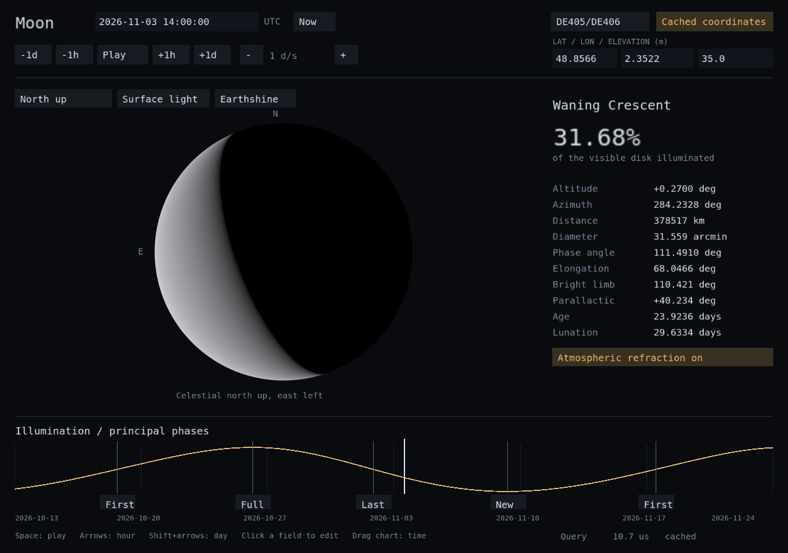
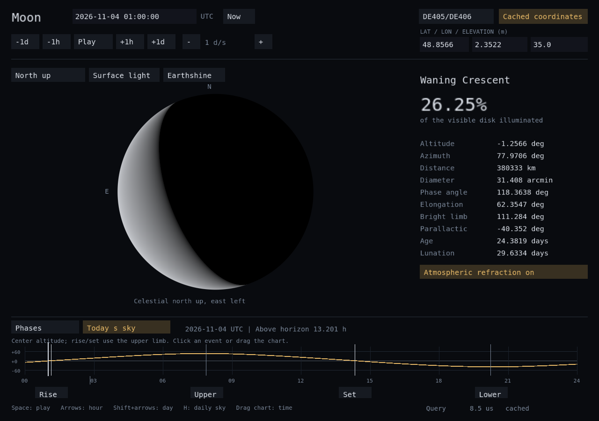
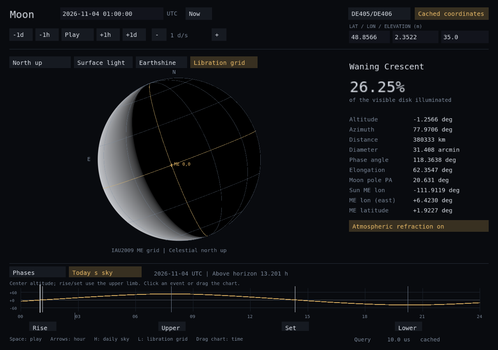

# Moon phase application

`spp_moon` is the OpenGL 3.3 desktop application. It draws the observer's
spherical lunar disk from Spp's calculated illumination, bright-limb position
angle and parallactic angle. It also shows sky coordinates, distance, angular
size, the age since the computed previous new Moon, the actual enclosing
lunation length, a 42-day illumination/phase timeline, and a daily altitude
chart with rise/set, meridian crossings and visibility duration.
An optional Mean Earth/Polar Axis grid shows libration and the apparent lunar pole.



## Build and open

```bash
cmake --preset moon
cmake --build --preset moon --target spp_moon
./build/moon-Linux/spp_moon
```

The preset separates `build/moon-Linux`, `build/moon-Windows` and
`build/moon-Darwin`, so Windows and NAS CMake caches cannot overwrite each
other. Dependencies are a C++23 compiler, Ninja, GLFW, GLEW and OpenGL.
The existing CLI/default build tasks remain available.

In VS Code, select **Tasks: Run Task → Moon: Run OpenGL App**. The task builds
the app first. **Moon: Build OpenGL App** only builds it.

The app opens on the computer executing it. A VS Code Remote SSH terminal
does not forward a window to Windows. To build a native Windows window from
the SMB-accessible source, use the existing Windows GCC/Ninja environment
with the graphics libraries available, in an MSYS2 UCRT64 terminal:

```bash
pacman -S --needed mingw-w64-ucrt-x86_64-gcc mingw-w64-ucrt-x86_64-cmake mingw-w64-ucrt-x86_64-ninja mingw-w64-ucrt-x86_64-glfw mingw-w64-ucrt-x86_64-glew
cd /a/Documents/Code/C-C++/Seasonal-plus-plus
cmake --preset moon
cmake --build --preset moon --target spp_moon spp_cli
./build/moon-Windows/spp_moon.exe
```

These are the [UCRT64 GLFW](https://packages.msys2.org/packages/mingw-w64-ucrt-x86_64-glfw)
and [GLEW](https://packages.msys2.org/packages/mingw-w64-ucrt-x86_64-glew)
packages. Running in that same local terminal supplies their DLLs through PATH.
For a specific date/location and to inspect the library through the CLI:

```bash
./build/moon-Windows/spp_moon.exe 2026-11-03 12:00 48.8566 2.3522 35 --events --grid
./build/moon-Windows/spp_moon.exe --help
./build/moon-Windows/spp.exe --help
./build/moon-Windows/spp.exe moon 2026-11-03 12:00
./build/moon-Windows/spp.exe moon sky 2026-11-03 12:00 48.8566 2.3522 35
./build/moon-Windows/spp.exe moon phase 2026-11-03 12:00
./build/moon-Windows/spp.exe moon day 2026-11-03 48.8566 2.3522 35
./build/moon-Windows/spp.exe moon rotation 2026-11-03 12:00
./build/moon-Windows/spp.exe moon surface 2026-11-03 12:00 48.8566 2.3522 35
```

The raw geometric `moon` and `moon rotation` commands take TDB. `moon sky`,
`moon phase`, `moon day`, `moon surface` and the GUI use UTC. The coordinates
above are Paris. Windows graphical
benchmarks use `--benchmark=120` without the Linux-only `--offscreen` option.

Windows execution has not been verified on the NAS. A graphical NAS session
can instead run the Linux binary. A headless NAS can run the rendering
benchmark below without an X11/Wayland desktop.

## Use

The default instant is the system's current UTC time. The initial observer is
Paris (48.8566 N, 2.3522 E, 35 m), not automatic geolocation. To reproduce the
worked example:

```bash
./build/moon-Linux/spp_moon 2026-11-03 12:00 48.8566 2.3522 35
```

- Click the UTC or location fields, type a value, and press Enter. Escape
  cancels. Ctrl+A/Ctrl+V and Backspace work in a focused field.
- Space plays/pauses; arrow keys step an hour, Shift+arrows a day.
  The buttons do the same. +/- change simulated days per real second.
- Drag the timeline to scrub time. Click New/First/Full/Last to jump to its
  computed instant; hover a phase marker to see its UTC timestamp.
- **O** switches celestial north up (east left) and local zenith up.
  **R** toggles refraction of the coordinate altitude.
- **F** switches DE405/DE406 and LLR fits. **D** compares cached and direct
  coordinate evaluation. The footer reports the latest observation cost.
- **G** switches surface lighting and uniform lit-area display. **E** toggles
  illustrative earthshine. **N** returns to current UTC.
- **L** or **Libration grid** toggles the IAU2009 body-fixed grid. The gold
  lines mark the equator and prime meridian. In this view the numeric rows show
  sub-observer longitude/latitude, subsolar longitude and lunar pole position
  angle. Longitudes are east-positive. `--grid` opens with the grid enabled.
- **H** or **Today's sky** switches to the UTC day's altitude chart. Drag it
  to change the time; click Rise/Set/Upper/Lower/Graze to jump to an event,
  or hover its vertical marker for the full time, center altitude and azimuth.
  Rise/set refer to the upper limb at a level horizon; transits are meridian
  crossings. The header reports duration above the horizon, including polar
  days without a rise or set. **Phases** returns to the lunation timeline.

`--events` opens the daily panel directly. Daily data has a separate coalescing,
cancellable worker and is recalculated when the UTC day, location, fitted set
or refraction changes. Superseded results are not displayed for a new request.

The separately selectable [numerical provider](lunar-integration.md) uses
`--model=integrated`, an existing kernel and an explicit TDB seed. The main
view and both workers share its immutable propagated trajectory. Its mode is
labeled **Numerical Moon / Stored trajectory**. F/D remain ELP controls.
No out-of-window request silently switches back to ELP or reseeds.
The [integrated-model capture](images/moon-integrated.png) comes from the
headless rendering benchmark; desktop Windows behavior remains unverified.





The illumination curve and phase events are generated by a background worker
with its own model instance. Repeated scrubbing cancels superseded work.
Paused windows wait for input/calendar completion instead of spinning a
render loop. Observation updates retain their cache across frames.

The visible disk uses topocentric illumination. `Observation.phase` remains
the geocentric almanac quantity; `Observation.disk` supplies observer-specific
phase angle, illuminated fraction, bright-limb angle and parallactic angle.
The direction flags identify undefined alignment/zenith cases.
`Observation.surface` supplies the independent body orientation and spherical
surface coordinates; see [lunar-rotation.md](lunar-rotation.md).

## Rendering performance

On Linux with EGL available, no desktop display is required:

```bash
./build/moon-Linux/spp_moon 2026-11-03 12:00 48.8566 2.3522 35 --offscreen --benchmark=120
./build/moon-Linux/spp_moon 2026-11-03 12:00 48.8566 2.3522 35 --offscreen --benchmark=120 --direct
./build/moon-Linux/spp_moon 2026-11-03 23:00 48.8566 2.3522 35 --events --offscreen --benchmark=120
./build/moon-Linux/spp_moon 2026-11-03 23:00 48.8566 2.3522 35 --events --grid --offscreen --benchmark=120
```

**Moon: OpenGL Performance (Headless Linux)** is the equivalent VS Code task.
`--step-seconds=60` is the default timeline workload. An explicit
`--capture=/tmp/moon-performance.ppm` writes the final rendered frame.
Without `--offscreen`, benchmark mode uses an invisible GLFW desktop window.

The benchmark reports OpenGL vendor/renderer, mean/median/p95/max frame time,
throughput, a result checksum and the number of observation ELP evaluations.
It times observation updates, UI construction, GPU drawing and `glFinish` at
1280x900. Initial calendar generation and warmup are excluded; later calendar
refreshes inside the measured time range are included. Swap/vsync waits are
excluded. The benchmark fails on invalid observations or OpenGL errors.
With `--events`, it also consumes and checks the daily result. It reports the
number of phase-calendar and daily-sky refreshes inside the measured interval.
Schedule generation uses the cached model in either coordinate mode. Headless
benchmark refreshes run synchronously and are included in frame latency;
interactive refreshes use the background workers. The example starting at
23:00 crosses midnight and includes one new daily calculation.

The NAS rendered the one-minute-step workload with Mesa llvmpipe (software
rendering). A 120-frame cached run measured 1.840 ms mean, 1.655 ms median and
3.132 ms p95, or 544 frames/s, with six new endpoint state evaluations.
The matching 120-frame direct run measured 9.715 ms mean, 8.894 ms median and
15.753 ms p95, or 103 frames/s, with 840 position evaluations. These results
establish a functioning renderer and the cache benefit
on that workload, not native GPU or Windows performance.

With the new grid and a midnight daily refresh, a 120-frame run measured
3.415 ms mean / 2.084 ms median cached versus 11.513 ms / 9.306 ms direct.
The result checksum agreed at the displayed precision. The cached run used
six new endpoint states; the direct run used 840 position evaluations.
Maximum frame latency (123.804 ms cached) includes the synchronous day refresh;
interactive windows calculate that schedule in a worker.

After optimizing propagation of the expanded gravity/tidal/solar model, the
same grid/daily workload measured 2.340 ms mean / 2.197 ms median / 4.162 ms
p95 / 5.632 ms maximum, including a midnight daily refresh. Initializing its
±90-day trajectory took **149.882 ms** at startup, including kernel loading,
versus 473.357 ms in the earlier run. The displayed checksum agrees exactly.
The optimization targets initialization; it does not establish a frame-time
speedup. These costs serve different workloads: a stored trajectory
avoids cold lunar-series fills over its window, but costs time and memory
up front. It does not replace the default ELP cache policy.

## Model and artwork limits

The disk is a spherical illumination rendering with an approximate IAU2009
rotation grid, without a lunar terrain map or differential atmospheric distortion. Display size is
chosen for readability; actual angular diameter is reported numerically.
Surface light uses a simplified lunar-style scattering law; the earthshine
switch is illustrative rather than a calibrated photometric prediction.
These displays do not simulate eclipses. Observer/phase accuracy inherits the
time/frame/model limits in [lunar-ephemeris.md](lunar-ephemeris.md).

The UI font atlas is embedded, so the application needs no external fonts
or network at runtime. DejaVu notices are in `data/licenses/DejaVu.txt`.
`tools/font_atlas.py` regenerates it with ImageMagick from DejaVu Sans Mono;
ordinary builds require neither that generator nor ImageMagick.
