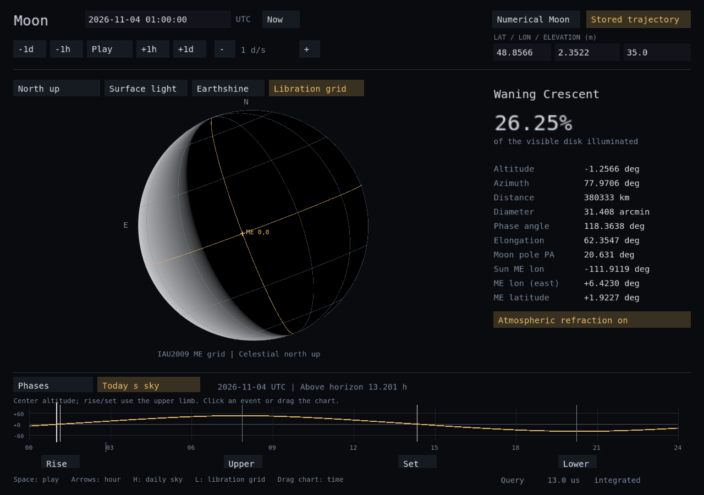

# Moon support

Spp provides a C++ lunar library, the `spp moon` CLI commands and the
`spp_moon` OpenGL application. The default is analytical ELP/MPP02 with a
bounded interpolation cache. A numerical orbit is explicitly selectable.



Actual capture from the current Linux headless rendering benchmark, showing
2026-11-04 01:00 UTC in Paris. The disk and chart are calculated by Spp.

## Implemented features

| Feature | Available results |
| --- | --- |
| Geometric orbit | Earth-centered position, velocity, distance, speed and J2000 ecliptic longitude/latitude |
| Observer coordinates | Altitude, azimuth, apparent right ascension/declination, unrefracted center altitude, range and angular size |
| Phase and illumination | Waxing/waning state, elongation, geocentric phase cycle and physical illuminated fraction |
| Principal phases | Computed new Moon, first quarter, full Moon and last quarter times |
| Daily events | Upper-limb rise/set, upper/lower meridian crossings, grazing contacts and duration above the configured horizon |
| Disk orientation | Observer-specific illumination, bright-limb position angle and parallactic angle |
| Surface orientation | IAU2009 lunar pole/prime meridian, libration grid, sub-observer/subsolar coordinates and view matrix |
| Model selection | Direct/cached ELP, both published fitted sets, or finite-window numerical propagation |

Altitude is angular height above the horizon. Azimuth is north = 0°, east =
90°, south = 180°, west = 270°. Latitude/longitude describe the observer on
Earth; the worked examples below use **Paris**, not automatic geolocation.

## Open the GUI on Windows

Use a **local MSYS2 UCRT64 terminal on Windows**. The source is already
accessible at `A:\Documents\Code\C-C++\Seasonal-plus-plus`.
The compiler, CMake/Ninja and GLFW/GLEW installation commands are in
[the application guide](moon-app.md#build-and-open).

```bash
cd /a/Documents/Code/C-C++/Seasonal-plus-plus
cmake --preset moon
cmake --build --preset moon --target spp_moon spp_cli
./build/moon-Windows/spp_moon.exe 2026-11-03 12:00 48.8566 2.3522 35 --events --grid
```

Running the NAS executable in a Remote SSH terminal opens a window on the
NAS's graphical session; it does not open a native Windows window. The `moon`
preset uses separate `build/moon-Windows` and `build/moon-Linux` directories.

The GUI includes:

- A calculated lunar disk, illumination, phase, distance and sky readouts.
- Editable UTC time and observer location, playback and time stepping.
- A scrubbable phase timeline, computed lunar age/lunation length and clickable
  principal-phase markers.
- **Today's sky** with altitude curve, event markers/tooltips and visibility duration.
- **Libration grid**, celestial-north/local-zenith orientation and surface readouts.
- Cached/direct ELP and fitted-set controls. Calendar/day calculations use
  cancellable background workers; paused windows wait for input.

**Space** plays/pauses; **arrows** step an hour, **Shift+arrows** a day;
**H** switches daily sky/phases, **L** toggles the grid, **O** changes orientation,
**R** toggles refraction, **F** changes ELP fit, **D** toggles direct/cached ELP,
and **N** returns to current UTC. The full controls are in [moon-app.md](moon-app.md).

## Explore the CLI

From that same Windows terminal:

```bash
./build/moon-Windows/spp.exe --help
./build/moon-Windows/spp.exe moon 2026-11-03 12:00
./build/moon-Windows/spp.exe moon sky 2026-11-03 12:00 48.8566 2.3522 35
./build/moon-Windows/spp.exe moon sky 2026-11-03 12:00 48.8566 2.3522 35 --no-refraction
./build/moon-Windows/spp.exe moon phase 2026-11-03 12:00
./build/moon-Windows/spp.exe moon day 2026-11-03 48.8566 2.3522 35
./build/moon-Windows/spp.exe moon rotation 2026-11-03 12:00
./build/moon-Windows/spp.exe moon surface 2026-11-03 12:00 48.8566 2.3522 35
```

| Command | Input time | Output |
| --- | --- | --- |
| `moon` | TDB | Geometric position/velocity and orbital direction |
| `moon sky` | UTC | Observer altitude/azimuth, equatorial coordinates, range, size and geocentric phase |
| `moon phase` | UTC | Illumination and the next 35 days of principal phases |
| `moon day` | UTC date | All horizon/meridian events and visibility duration for that day |
| `moon rotation` | TDB | IAU2009 pole, prime meridian, rates and axes |
| `moon surface` | UTC | Libration and surface orientation, geocentric or for an observer |

The GUI also takes **UTC**. TDB is the orbital model's time scale and is
explicitly labeled; neither is the Windows local clock time. Orbital ELP
commands accept `--fit=de405` or `--fit=llr`. Observer options include
`--no-refraction`, pressure/temperature overrides and explicit DUT1.

On the NAS, build and explore through the Linux CLI:

```bash
cd /mnt/storage/Documents/Code/C-C++/Seasonal-plus-plus
cmake --preset moon
cmake --build --preset moon --target spp_moon spp_cli
./build/moon-Linux/spp moon sky 2026-11-03 12:00 48.8566 2.3522 35
./build/moon-Linux/spp moon phase 2026-11-03 12:00
./build/moon-Linux/spp moon day 2026-11-03 48.8566 2.3522 35
```

## Choose the orbital implementation

**ELP/MPP02** evaluates all 35,901 analytical terms, with either DE405/DE406
or LLR-adjusted parameters. It needs no runtime kernel. Geometric defaults
evaluate the full series directly; default observations/events use a
per-thread, twenty-minute Hermite cache sampled from that full series.
An isolated cache fill costs two full state evaluations; resident evaluation
is much faster. There is no series truncation or automatic model switching.

**Numerical propagation** computes the Moon's trajectory from one explicit
seed over a finite window. The supplied SPK provides that initial state and
prescribed planetary/EMB trajectories. The propagated lunar separation drives
the Earth/Moon positions; kernel lunar states are not read again after seeding.
Both models feed the same observation/event APIs.

To open the numerical GUI on Windows with the existing local kernel:

```bash
./build/moon-Windows/spp_moon.exe 2026-11-04 12:00 48.8566 2.3522 35 --events --grid --model=integrated "--kernel=context/Spp Moon/reference-data/de440s.bsp" --seed=2026-11-03T12:00
./build/moon-Windows/spp.exe moon sky 2026-11-04 12:00 48.8566 2.3522 35 --model=integrated "--kernel=context/Spp Moon/reference-data/de440s.bsp" --seed=2026-11-03T12:00
```

Here the observation is UTC and the seed is **TDB**. The GUI propagates 90 days
each side of the seed; the CLI defaults to 45. `--span-days` changes that
explicit window. Outside it, requests fail rather than reseeding or switching
models. F/D and `--fit` remain ELP controls.

The numerical forces include Earth/Moon attraction, Sun/planetary-system
perturbations, major-body 1PN, Earth zonals through degree 5, lunar harmonics
through degree/order 6, delayed tidal/spin deformation, figure reactions and
small solar J2/radiation/frame-dragging effects. It is a reduced force model,
not the complete DE440 dynamical model. See [lunar-integration.md](lunar-integration.md).

## C++ API

The library builds as C++20; the supplied applications use C++23. Link to
`spp::spp`. A complete cached-ELP example:

```cpp
#include <cstdio>
#include <spp/spp.hpp>
#include <spp/model/elp_mpp02.hpp>

int main() {
    const auto time = spp::Time::from_utc(2026, 11, 3, 12);
    const auto midnight = spp::Time::from_utc(2026, 11, 3, 0);
    const spp::Observer paris{48.8566, 2.3522, 35};
    spp::model::elp_mpp02::CachedEphemeris orbit;

    const auto observation = spp::moon::observe(time, paris, orbit);
    const auto phases = spp::moon::phases(time, time.shifted(35), orbit);
    const auto day = spp::moon::horizon(midnight, midnight.shifted(1), paris, orbit);

    std::printf("Altitude %.6f deg; azimuth %.6f deg; illuminated %.4f%%\n",
        observation.horizontal.alt_deg, observation.horizontal.az_deg,
        100 * observation.disk.illuminated_fraction);
    std::printf("%zu upcoming phases; %zu daily events; %.4f hours visible\n",
        phases.size(), day.events.size(), day.duration_hours);
}
```

`moon::coordinates`/`horizontal` omit full disk/surface work. `geometric` and
`position` expose typed orbital states. `phase`, `phases`, `horizon`, `surface`
and `observe` accept explicit providers. Orbital and rotation providers are
independently replaceable; incompatible origin/frame/time tags require explicit
adapters. Cached ELP providers belong to one thread; the completed numerical
trajectory can be shared read-only. The generic integrator, SPK reader,
rotations and interpolation utilities support future implementations, while
the current public Moon observation/event rules remain terrestrial-lunar rules.
Other planets/moons and a lunar C ABI are not implemented.

## Measured performance and accuracy

These are NAS GCC 14.2 Release measurements on one thread. Resident and
initial-fill costs describe different workloads:

| Workload | Measured cost |
| --- | --- |
| Direct ELP position / full state | About 1.0 / 1.2 ms |
| Resident cached ELP coordinates / full observation | About 2.3–2.5 / 5.3–5.8 us |
| ELP coordinates with a forced lunar-cache miss | About 2.4–2.6 ms |
| 35-day ELP phase search | About 0.168 ms resident; 102 ms with an empty lunar cache; 302 ms direct |
| Numerical 180-day trajectory preparation | 467.028 → 138.703 ms median, 3.37 times faster |
| Four numerical trajectories for 62 phase checks | 3.918 → 1.178 s median |
| Resident numerical coordinates / full observation | About 3 / 7 us |
| Numerical GUI, 120 software-rendered frames | About 150–160 ms initialization; 1.9–2.2 ms median frame across two runs |

The numerical optimization preserves the force configuration and RK settings.
Its environment adds about 666 KiB beside a 2.75-MB trajectory and shared
32.7-MB kernel. See [the detailed measurements](lunar-integration.md#reproduce-accuracy-and-performance-measurements).

All ten report stages passed. Selected independent/sample comparisons:

| Check | Maximum sampled residual |
| --- | --- |
| ELP sky direction vs Horizons DE441 | 1.015 arcseconds, 15 observer cases |
| ELP observer range vs Horizons | 21.315 m |
| Illumination vs Horizons | 0.00001946 percentage points, 20 cases |
| ELP phase times vs matched-TT DE441 arcs | 0.211037 s, 62 events |
| Numerical phase times vs the same arcs | 0.268178 s, 62 events |
| Numerical orbit vs DE440s, 2026 +/-90 days | 0.020164 m at 1441 samples |
| Numerical cached/direct trajectory difference | 0.04173 mm at 2881 samples over that window |
| ELP cache/direct position, sampled 2000–2100 | 0.8061 mm per Cartesian component, both fits |

The numerical orbit comparison starts from a reference-correlated seed. These
are finite sampled residuals, not global guarantees or interchangeable error
definitions. USNO's separate minute-resolution table comparisons are not
second-resolution physical validation. Horizon events have numerical
dense/direct comparisons; independent physical moonrise validation remains
outstanding. Full coverage and reference conventions are in
[lunar-testing.md](lunar-testing.md).

To run the full report on the NAS:

```bash
cmake --preset moon "-DSPP_MOON_REFERENCE_KERNEL=/mnt/storage/Documents/Code/C-C++/Seasonal-plus-plus/context/Spp Moon/reference-data/de440s.bsp"
cmake --build --preset moon --target spp_moon_report
```

On Windows, configure the reference file using its Windows path:

```bash
cmake --preset moon "-DSPP_MOON_REFERENCE_KERNEL=A:/Documents/Code/C-C++/Seasonal-plus-plus/context/Spp Moon/reference-data/de440s.bsp"
cmake --build --preset moon --target spp_moon_report
```

Without the optional kernel, the report runs nine stages. No build downloads
runtime ephemerides. VS Code also provides **Moon: Build OpenGL App**,
**Moon: Run OpenGL App**, **Moon: Run Daily Sky**, and accuracy/speed tasks.

## Current limits

The display is a spherical Moon with a coordinate grid, not terrain imagery.
IAU2009 orientation is approximate; integrated mantle/core rotation is absent.
The numerical model omits asteroids and fully coupled solar-system dynamics.
Tidal lunar source history is a bounded local prediction. The shared observer
pipeline omits measured celestial-pole/polar-motion corrections, solar
barycentric motion and full relativistic light bending. Atmospheric refraction
is a model; terrain, extinction and automatic horizon dip are absent. Eclipses
are not predicted. Ancient/future time uncertainty and physical accuracy are
separate from the analytical engine's computational date bounds.

Linux builds, numerical/accuracy gates and headless rendering have been
verified. Native Windows builds and desktop input/window behavior still need
validation on Windows. Detailed contracts and provenance:
[ephemeris/coordinates](lunar-ephemeris.md), [rotation](lunar-rotation.md),
[numerical integration](lunar-integration.md), [application](moon-app.md).
